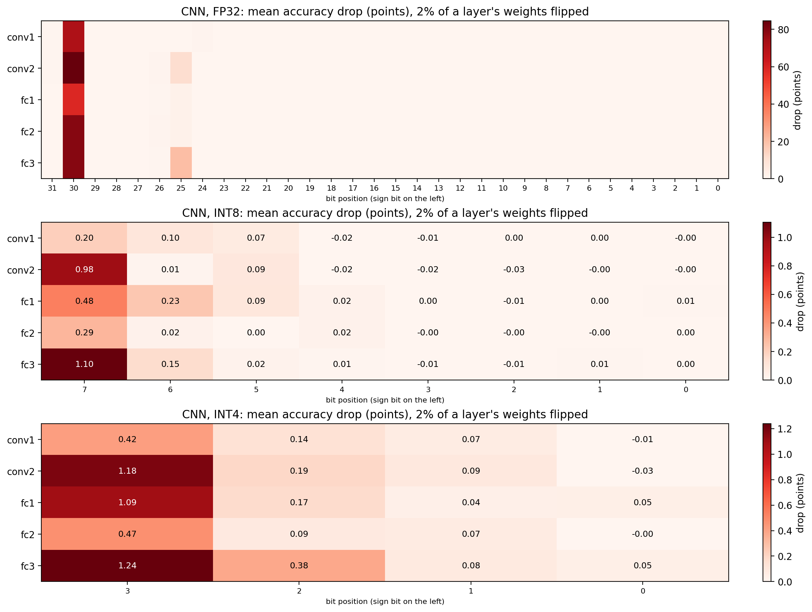
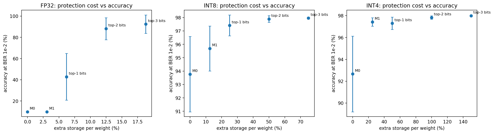
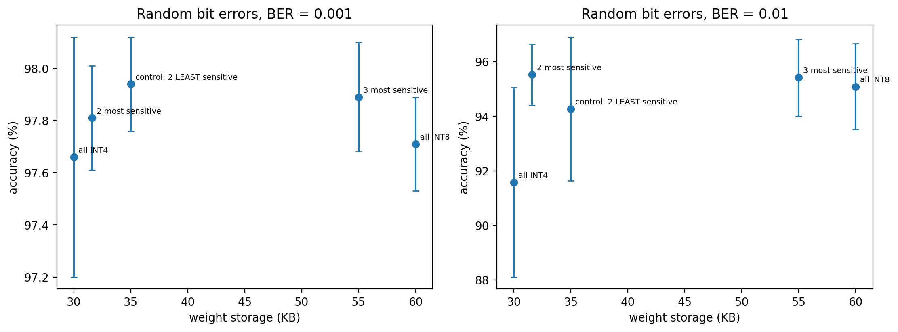
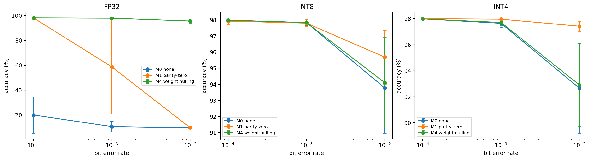
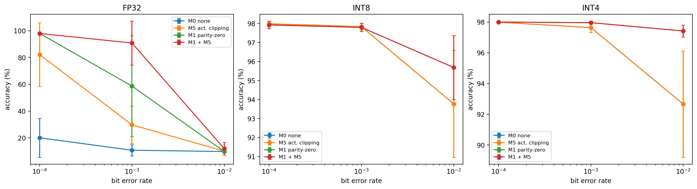
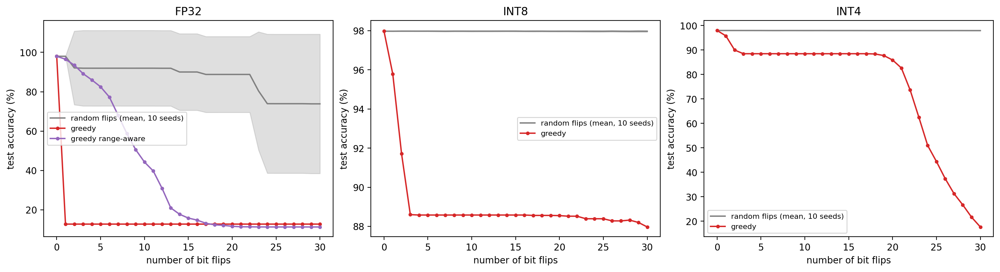
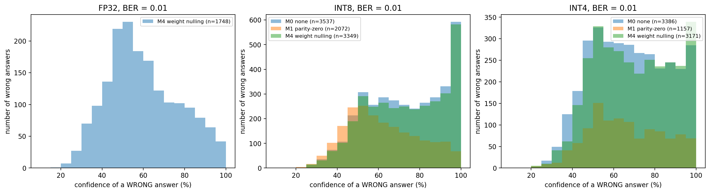
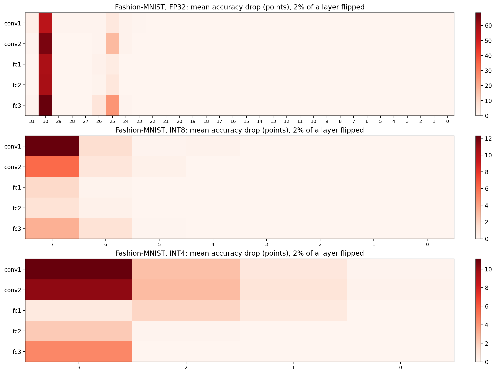
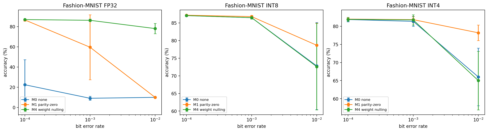

# Colab Codes and Outputs

**Project:** Bit-Position and Layer Sensitivity of Quantized CNNs under Weight Bit-Flip Faults, with a Low-Cost Hardware-Aware Mitigation

This project was built in **Google Colab** (experiments) and **VS Code** (Streamlit site). The codes below are the **main Colab codes**, in the order they were run. Under each code: what it does, the full code, the printed output, and what happened. Figures are saved in `results/`. All results are simulation only.

## Contents

1. Setup and unit tests
2. Step 1: pipeline check on a small MLP (day 1)
3. Step 1b: cleaner heatmaps for the MLP
4. Code 1: the CNN, quantization and the bit-flip functions
5. Code 2: layer x bit sweep on the CNN (5 seeds)
6. Code 4: protection M2, protect only the top-k most sensitive bit positions
7. Code 5: protection M3, mixed precision by layer
8. Code 6: parity-zero checker in Verilog, with an exhaustive testbench
9. Code 7: Yosys, how big is the parity checker?
10. Code 8b: final layer x bit sweep with 10 seeds and 95% bootstrap confidence intervals
11. Code 10: faults in the SCALE FACTOR (per-tensor vs per-channel)
12. Code 11 FINAL: manual-input demo (defines the functions)
13. Code 11b: run the manual-input demo
14. Code 13: protection M4, weight nulling (range check)
15. Code 14: protection M5, activation clipping (Ranger-style)
16. Code 15: M1 + M4 together (parity-zero and weight nulling), FP32 only
17. Code 16: the attacker, greedy bit search vs random flips
18. Code 17: confidence analysis, how sure is a wrong model?
19. Code 18: second dataset, Fashion-MNIST
20. Export cell: save the model and samples for the website

---

## 1. Setup and unit tests

**What this code does:** Unzips my project folder (the helper files src/flip.py, src/quant.py and src/eval.py plus the tests) into Colab and runs the 16 unit tests that check the quantization and bit-flip functions.

```python
!unzip -oq quantized-bitflip-study.zip -d /content
%cd /content/quantized-bitflip-study
!python -m pytest -q tests
```

**Output:**

```text
/content/quantized-bitflip-study
................                                                         [100%]
16 passed in 5.79s
```

**What happened, in simple words:**

- All 16 tests passed. So before running any experiment I knew that the bit-flip and quantization functions do what they should.

---

## 2. Step 1: pipeline check on a small MLP (day 1)

**What this code does:** A first end-to-end test of the whole idea on a tiny network (an MLP) before moving to the CNN. It trains the MLP on MNIST for 3 epochs, measures clean accuracy in FP32, INT8 and INT4, then flips one bit position at a time in 2% of one layer's weights (5 random seeds) and draws a heatmap of the accuracy drop.

```python
import os
os.chdir("/content/quantized-bitflip-study")   # make sure we are inside the project

import torch
import pandas as pd
import matplotlib.pyplot as plt
from src.eval import load_mnist, make_mlp, train, accuracy, corrupt_model, linear_layers
from src.quant import NBITS

# --- Step 1: train the baseline model ---
torch.manual_seed(0)
train_dl, test_dl = load_mnist()
model = train(make_mlp(), train_dl, epochs=3)
print("FP32 clean accuracy:", accuracy(model, test_dl))
torch.save(model.state_dict(), "results/mlp_mnist_fp32.pt")

# --- Step 2: clean accuracy in each format (no bit flips) ---
for fmt in NBITS:
    print(fmt, "clean accuracy:", round(accuracy(corrupt_model(model, fmt), test_dl), 2))

# --- Step 3: flip one bit position at a time (2% of a layer's weights, 5 seeds) ---
FRAC, SEEDS = 0.02, range(5)
rows = []
for fmt, nbits in NBITS.items():
    clean = accuracy(corrupt_model(model, fmt), test_dl)
    for layer in range(len(linear_layers(model))):
        for bit in range(nbits):
            for seed in SEEDS:
                gen = torch.Generator().manual_seed(seed)
                m = corrupt_model(model, fmt, [layer], "bit", gen, bit=bit, frac=FRAC)
                acc = accuracy(m, test_dl)
                rows.append(dict(model="mlp", dataset="mnist", fmt=fmt, layer=layer, bit=bit,
                                 seed=seed, frac=FRAC, clean_acc=clean, acc=acc, drop=clean - acc))
df = pd.DataFrame(rows)
df.to_csv("results/day1_bit_sweep.csv", index=False)
print(len(df), "trials saved to results/day1_bit_sweep.csv")

# --- Step 4: heatmaps (sign bit on the left) ---
vmax = df["drop"].max()
fig, axes = plt.subplots(3, 1, figsize=(12, 7))
for ax, fmt in zip(axes, NBITS):
    t = df[df.fmt == fmt].pivot_table(index="layer", columns="bit", values="drop", aggfunc="mean")
    t = t[sorted(t.columns, reverse=True)]
    im = ax.imshow(t.values, cmap="Reds", aspect="auto", vmin=0, vmax=vmax)
    ax.set_xticks(range(t.shape[1])); ax.set_xticklabels(t.columns, fontsize=7)
    ax.set_yticks(range(t.shape[0])); ax.set_yticklabels([f"layer {l}" for l in t.index])
    ax.set_title(f"{fmt}: mean accuracy drop (points)")
fig.colorbar(im, ax=axes, label="accuracy drop (points)")
plt.savefig("figures/day1_heatmaps.png", dpi=200, bbox_inches="tight")
plt.show()

for fmt in ["int8", "int4"]:
    print(fmt, "- mean accuracy drop (points)")
    print(df[df.fmt == fmt].pivot_table(index="layer", columns="bit", values="drop", aggfunc="mean").round(2), "\n")
```

**Output:**

```text
FP32 clean accuracy: 96.39
fp32 clean accuracy: 96.39
int8 clean accuracy: 96.38
int4 clean accuracy: 96.27
440 trials saved to results/day1_bit_sweep.csv
int8 - mean accuracy drop (points)
bit      0     1     2     3     4     5     6     7
layer                                               
0      0.0  0.01  0.02  0.02 -0.02  0.09  0.24  0.73
1      0.0 -0.00  0.02  0.02  0.04  0.20  0.75  4.13 

int4 - mean accuracy drop (points)
bit       0     1     2     3
layer                        
0      0.04  0.17  0.46  1.11
1      0.03  0.13  0.95  5.22
```


**What happened, in simple words:**

- Clean accuracy: FP32 96.39%, INT8 96.38%, INT4 96.27%. The quantized formats lose almost nothing.
- 440 trials were saved. In INT8 and INT4 the sign bit (the highest bit) is clearly the most harmful: in INT8, bit 7 costs 0.73 points in layer 0 and 4.13 points in layer 1; in INT4, bit 3 costs 1.11 and 5.22 points. Lower bits cost almost nothing.
- This showed that the pipeline works and that the idea is worth running on a CNN.

---

## 3. Step 1b: cleaner heatmaps for the MLP

**What this code does:** Re-draws the same heatmaps as Step 1 with its own colour scale for each format and the numbers written inside the INT8 and INT4 boxes, so small values are readable. Uses the table df from Step 1.

```python
import matplotlib.pyplot as plt

fig, axes = plt.subplots(3, 1, figsize=(12, 8), constrained_layout=True)
for ax, fmt in zip(axes, ["fp32", "int8", "int4"]):
    t = df[df.fmt == fmt].pivot_table(index="layer", columns="bit", values="drop", aggfunc="mean")
    t = t[sorted(t.columns, reverse=True)]                  # sign bit on the left
    vmax = max(t.values.max(), 1.0)                         # own colour scale for each format
    im = ax.imshow(t.values, cmap="Reds", aspect="auto", vmin=0, vmax=vmax)
    ax.set_xticks(range(t.shape[1])); ax.set_xticklabels(t.columns, fontsize=8)
    ax.set_yticks(range(t.shape[0])); ax.set_yticklabels([f"layer {l}" for l in t.index])
    ax.set_xlabel("bit position (sign bit on the left)", fontsize=8)
    ax.set_title(f"{fmt.upper()}: mean accuracy drop (points)", fontsize=10)
    if t.shape[1] <= 8:                                     # write numbers inside INT8/INT4 cells
        for i in range(t.shape[0]):
            for j in range(t.shape[1]):
                v = t.values[i, j]
                ax.text(j, i, f"{v:.2f}", ha="center", va="center", fontsize=9,
                        color="white" if v > 0.6 * vmax else "black")
    fig.colorbar(im, ax=ax, label="drop (points)")
plt.savefig("figures/day1_heatmaps_fixed.png", dpi=200, bbox_inches="tight")
plt.show()
```

*(No text output.)*


**What happened, in simple words:**

- No text is printed. The result is the picture figures/day1_heatmaps_fixed.png: darker red means more accuracy lost, and the sign bit is on the left.

---

## 4. Code 1: the CNN, quantization and the bit-flip functions

**What this code does:** The base of the whole project. It downloads MNIST, builds a LeNet-style CNN (conv1, conv2, fc1, fc2, fc3 with ReLU and max-pooling) and trains it for 3 epochs with Adam. It also defines the key functions: acc() measures accuracy, quantize() stores a layer in FP32, INT8 or INT4 (one scale per layer), flip_bit() flips one chosen bit in a random share of the stored weights, and build() makes a copy of the model with the weights stored in a format and, if asked, one bit flipped.

```python
import copy
import torch
import torch.nn as nn
from torchvision import datasets

# ---------- data (MNIST downloads automatically) ----------
tr = datasets.MNIST("data", train=True, download=True)
te = datasets.MNIST("data", train=False, download=True)
Xtr, Ytr = (tr.data.float() / 255).unsqueeze(1), tr.targets
Xte, Yte = (te.data.float() / 255).unsqueeze(1), te.targets

# ---------- CNN (LeNet-style, ~61k parameters) ----------
torch.manual_seed(0)
cnn = nn.Sequential(
    nn.Conv2d(1, 6, 5, padding=2), nn.ReLU(), nn.MaxPool2d(2),
    nn.Conv2d(6, 16, 5), nn.ReLU(), nn.MaxPool2d(2),
    nn.Flatten(),
    nn.Linear(400, 120), nn.ReLU(),
    nn.Linear(120, 84), nn.ReLU(),
    nn.Linear(84, 10),
)
opt = torch.optim.Adam(cnn.parameters(), lr=1e-3)
g_train = torch.Generator().manual_seed(0)
for epoch in range(3):
    perm = torch.randperm(len(Xtr), generator=g_train)
    for i in range(0, len(Xtr), 128):
        idx = perm[i:i + 128]
        opt.zero_grad()
        nn.functional.cross_entropy(cnn(Xtr[idx]), Ytr[idx]).backward()
        opt.step()


def acc(m):
    """Test accuracy in percent."""
    with torch.no_grad():
        return 100 * (m(Xte).argmax(1) == Yte).float().mean().item()


# ---------- quantization and bit flips ----------
NB = {"fp32": 32, "int8": 8, "int4": 4}
LAYER_NAMES = ["conv1", "conv2", "fc1", "fc2", "fc3"]


def wlayers(m):
    """Conv2d and Linear layers, in network order."""
    return [x for x in m.modules() if isinstance(x, (nn.Conv2d, nn.Linear))]


def quantize(w, fmt):
    if fmt == "fp32":
        return w.clone(), torch.tensor(1.0)
    qmax = 2 ** (NB[fmt] - 1) - 1
    scale = w.abs().max() / qmax
    return torch.clamp(torch.round(w / scale), -(qmax + 1), qmax).to(torch.int8), scale


def flip_bit(q, fmt, bit, frac, gen):
    """Flip bit `bit` (0 = least significant) in a random `frac` of the stored weights."""
    flat = q.reshape(-1)
    idx = torch.randperm(flat.numel(), generator=gen)[:int(frac * flat.numel())]
    masks = torch.zeros(flat.numel(), dtype=torch.int64)
    masks[idx] = 1 << bit
    if fmt == "fp32":
        out = (flat.contiguous().view(torch.int32) ^ masks.to(torch.int32)).view(torch.float32)
    else:
        nb = NB[fmt]
        raw = (flat.to(torch.int64) & ((1 << nb) - 1)) ^ masks
        out = torch.where(raw >= (1 << (nb - 1)), raw - (1 << nb), raw).to(torch.int8)
    return out.reshape(q.shape)


def build(model, fmt, layer=None, bit=None, frac=0.02, gen=None):
    """Copy of `model` with all weights stored in `fmt`; if `layer` is given,
    flip `bit` in `frac` of that layer's weights. Biases are left untouched."""
    m = copy.deepcopy(model)
    for li, lay in enumerate(wlayers(m)):
        q, s = quantize(lay.weight.data, fmt)
        if li == layer:
            q = flip_bit(q, fmt, bit, frac, gen)
        lay.weight.data = q if fmt == "fp32" else q.float() * s
    return m


print("CNN parameters:", sum(p.numel() for p in cnn.parameters()))
for fmt in NB:
    print(f"{fmt} clean accuracy: {acc(build(cnn, fmt)):.2f}")
```

**Output:**

```text
CNN parameters: 61706
fp32 clean accuracy: 98.00
int8 clean accuracy: 97.98
int4 clean accuracy: 98.00
```

**What happened, in simple words:**

- The network has exactly 61,706 parameters.
- Clean accuracy: FP32 98.00%, INT8 97.98%, INT4 98.00%. Storing the weights in 8 or 4 bits costs almost nothing in accuracy.

---

## 5. Code 2: layer x bit sweep on the CNN (5 seeds)

**What this code does:** The main sensitivity experiment, first version. For FP32, INT8 and INT4 it flips every bit position, one at a time, in 2% of the weights of every layer, with 5 random seeds (1,100 trials). It saves the results, draws heatmaps and prints the mean accuracy drop (with standard deviation) for the most dangerous bit of each format.

```python
import pandas as pd
import matplotlib.pyplot as plt

FRAC, SEEDS = 0.02, range(5)
rows = []
for fmt, nbits in NB.items():
    clean = acc(build(cnn, fmt))
    for layer in range(5):
        for bit in range(nbits):
            for seed in SEEDS:
                gen = torch.Generator().manual_seed(seed)
                a = acc(build(cnn, fmt, layer, bit, FRAC, gen))
                rows.append(dict(model="cnn", dataset="mnist", fmt=fmt, layer=layer, bit=bit,
                                 seed=seed, frac=FRAC, clean_acc=clean, acc=a, drop=clean - a))
    print(fmt, "done")
df_cnn = pd.DataFrame(rows)
df_cnn.to_csv("cnn_bit_sweep.csv", index=False)
print(len(df_cnn), "trials saved to cnn_bit_sweep.csv")

# ---------- heatmaps (own colour scale per format) ----------
fig, axes = plt.subplots(3, 1, figsize=(12, 9), constrained_layout=True)
for ax, fmt in zip(axes, NB):
    t = df_cnn[df_cnn.fmt == fmt].pivot_table(index="layer", columns="bit", values="drop", aggfunc="mean")
    t = t[sorted(t.columns, reverse=True)]
    vmax = max(t.values.max(), 1.0)
    im = ax.imshow(t.values, cmap="Reds", aspect="auto", vmin=0, vmax=vmax)
    ax.set_xticks(range(t.shape[1])); ax.set_xticklabels(t.columns, fontsize=8)
    ax.set_yticks(range(5)); ax.set_yticklabels(LAYER_NAMES)
    ax.set_xlabel("bit position (sign bit on the left)", fontsize=8)
    ax.set_title(f"CNN, {fmt.upper()}: mean accuracy drop (points), {FRAC * 100:.0f}% of a layer's weights flipped")
    if t.shape[1] <= 8:
        for i in range(t.shape[0]):
            for j in range(t.shape[1]):
                v = t.values[i, j]
                ax.text(j, i, f"{v:.2f}", ha="center", va="center", fontsize=9,
                        color="white" if v > 0.6 * vmax else "black")
    fig.colorbar(im, ax=ax, label="drop (points)")
plt.savefig("cnn_heatmaps.png", dpi=200, bbox_inches="tight")
plt.show()

# ---------- worst bit per layer: mean and std over 5 seeds ----------
pd.set_option("display.width", 200)
pd.set_option("display.max_columns", 20)
top = {"fp32": 30, "int8": 7, "int4": 3}          # FP32 exponent MSB, INT sign bits
parts = []
for fmt, bit in top.items():
    g = df_cnn[(df_cnn.fmt == fmt) & (df_cnn.bit == bit)].groupby("layer").drop.agg(["mean", "std"]).round(2)
    g.index = LAYER_NAMES
    g.columns = [f"{fmt} bit{bit} mean", f"{fmt} std"]
    parts.append(g)
print(pd.concat(parts, axis=1))

from google.colab import files
files.download("cnn_bit_sweep.csv")
files.download("cnn_heatmaps.png")
```

**Output:**

```text
fp32 done
int8 done
int4 done
1100 trials saved to cnn_bit_sweep.csv
       fp32 bit30 mean  fp32 std  int8 bit7 mean  int8 std  int4 bit3 mean  int4 std
conv1            71.16     22.62            0.20      0.24            0.42      0.17
conv2            84.50     11.32            0.98      0.75            1.18      0.62
fc1              58.46     14.10            0.48      0.53            1.09      0.25
fc2              78.92      4.57            0.29      0.34            0.47      0.37
fc3              79.00      7.95            1.10      0.52            1.24      0.46
```



**What happened, in simple words:**

- FP32: bit 30 (the top exponent bit) is the dangerous one. Mean accuracy drop: conv1 71.2, conv2 84.5, fc1 58.5, fc2 78.9, fc3 79.0 points.
- INT8, sign bit (bit 7): drops of only 0.20 to 1.10 points. INT4, sign bit (bit 3): 0.42 to 1.24 points.
- So one bit position in FP32 can destroy the network, while in INT8 and INT4 no single bit costs more than about 1 point in this first run. The final 10-seed version of this table is in Code 8b.

---

## 6. Code 4: protection M2, protect only the top-k most sensitive bit positions

**What this code does:** Tests a cheap idea: shield only the few most harmful bit positions (found from the sweep) and leave the rest unprotected. Random bit errors are applied to every stored bit at error rates 1e-3 and 1e-2, with 10 seeds. Each shielded bit is assumed to be perfectly protected by triple redundancy (2 extra copies), so protecting k bits costs 2k extra bits per weight. The code also compares with M1 parity-zero (one parity bit per weight; a weight that fails the check is read as 0).

```python
# ===== CODE 4: M2 - protect only the top-k most sensitive bit positions =====
import copy
import numpy as np
import pandas as pd
import matplotlib.pyplot as plt


def corrupt_prot(model, fmt, ber, seed, protected=(), parity=False):
    """Random bit faults over ALL weights (every stored bit flips with probability `ber`).
    protected : bit positions that are shielded (e.g. by TMR / ECC) and are NEVER flipped.
    parity    : also use parity-zero (M1), same as in Code 3.
    The same seed gives the same random numbers for every setting, so comparisons are fair."""
    nb = NB[fmt]
    gen = torch.Generator().manual_seed(seed)
    m = copy.deepcopy(model)
    for lay in wlayers(m):
        q, s = quantize(lay.weight.data, fmt)
        flat = q.reshape(-1)
        hits = torch.rand(flat.numel(), nb + 1, generator=gen) < ber      # last column = parity bit
        for b in protected:
            hits[:, b] = False                                           # shielded bits never flip
        mask = (hits[:, :nb].long() << torch.arange(nb)).sum(1)
        if fmt == "fp32":
            mask32 = torch.where(mask >= 2 ** 31, mask - 2 ** 32, mask).to(torch.int32)
            out = (flat.contiguous().view(torch.int32) ^ mask32).view(torch.float32)
        else:
            raw = (flat.to(torch.int64) & ((1 << nb) - 1)) ^ mask
            out = torch.where(raw >= (1 << (nb - 1)), raw - (1 << nb), raw).to(torch.int8)
        if parity:
            out = torch.where(hits.sum(1) % 2 == 1, torch.zeros_like(out), out)
        out = out.reshape(q.shape)
        lay.weight.data = out if fmt == "fp32" else out.float() * s
    return m


# Which bits are most sensitive? Rank bit positions by the mean drop in the bit sweep (df_cnn).
rank = {f: list(df_cnn[df_cnn.fmt == f].groupby("bit").drop.mean().sort_values(ascending=False).index)
        for f in NB}
for f in NB:
    print(f"{f}: most sensitive bits, worst first: {rank[f][:4]}")

BERS, SEEDS, KS = [1e-3, 1e-2], range(10), [1, 2, 3]
rows = []
for fmt in NB:
    nb = NB[fmt]
    clean = acc(build(cnn, fmt))
    configs = [("M0 none", (), False, 0.0), ("M1 parity-zero", (), True, 100 / nb)]
    for k in KS:   # TMR assumption: each protected bit needs 2 extra copies -> 2k extra bits per weight
        configs.append((f"M2 top-{k} bits", tuple(rank[fmt][:k]), False, 200 * k / nb))
    for ber in BERS:
        for name, prot, par, extra in configs:
            for seed in SEEDS:
                rows.append(dict(fmt=fmt, ber=ber, config=name, extra_storage_pct=round(extra, 1), seed=seed,
                                 clean=clean, acc=acc(corrupt_prot(cnn, fmt, ber, seed, prot, par))))
    print(fmt, "done")
dfm2 = pd.DataFrame(rows)
dfm2.to_csv("cnn_topk_protection.csv", index=False)

pd.set_option("display.width", 200)
tab = dfm2.groupby(["fmt", "ber", "config", "extra_storage_pct"]).acc.agg(["mean", "std"]).round(2).reset_index()
print(tab.to_string(index=False))

fig, axes = plt.subplots(1, 3, figsize=(15, 4), constrained_layout=True)
for ax, fmt in zip(axes, NB):
    t = tab[(tab.fmt == fmt) & (tab.ber == 1e-2)]
    ax.errorbar(t.extra_storage_pct, t["mean"], t["std"], fmt="o", capsize=3)
    for _, r in t.iterrows():
        ax.annotate(r.config.split(" ", 1)[1] if r.config.startswith("M2") else r.config.split()[0],
                    (r.extra_storage_pct, r["mean"]), textcoords="offset points", xytext=(5, 5), fontsize=8)
    ax.set_xlabel("extra storage per weight (%)")
    ax.set_ylabel("accuracy at BER 1e-2 (%)")
    ax.set_title(f"{fmt.upper()}: protection cost vs accuracy")
plt.savefig("cnn_topk_protection.png", dpi=200, bbox_inches="tight")
plt.show()

from google.colab import files
files.download("cnn_topk_protection.csv")
files.download("cnn_topk_protection.png")
```

**Output:**

```text
fp32: most sensitive bits, worst first: [30, 25, 26, 24]
int8: most sensitive bits, worst first: [7, 6, 5, 4]
int4: most sensitive bits, worst first: [3, 2, 1, 0]
fp32 done
int8 done
int4 done
 fmt   ber         config  extra_storage_pct  mean   std
fp32 0.001        M0 none                0.0 10.75  4.17
fp32 0.001 M1 parity-zero                3.1 58.67 37.73
fp32 0.001  M2 top-1 bits                6.2 95.84  2.75
fp32 0.001  M2 top-2 bits               12.5 97.62  0.33
fp32 0.001  M2 top-3 bits               18.8 97.69  0.21
fp32 0.010        M0 none                0.0  9.80  0.00
fp32 0.010 M1 parity-zero                3.1  9.80  0.00
fp32 0.010  M2 top-1 bits                6.2 42.79 22.04
fp32 0.010  M2 top-2 bits               12.5 88.19 10.36
fp32 0.010  M2 top-3 bits               18.8 92.42  8.66
int4 0.001        M0 none                0.0 97.64  0.33
int4 0.001 M1 parity-zero               25.0 97.96  0.10
int4 0.001  M2 top-1 bits               50.0 97.87  0.16
int4 0.001  M2 top-2 bits              100.0 97.98  0.05
int4 0.001  M2 top-3 bits              150.0 97.99  0.03
int4 0.010        M0 none                0.0 92.66  3.46
int4 0.010 M1 parity-zero               25.0 97.42  0.39
int4 0.010  M2 top-1 bits               50.0 97.30  0.57
int4 0.010  M2 top-2 bits              100.0 97.83  0.15
int4 0.010  M2 top-3 bits              150.0 97.99  0.07
int8 0.001        M0 none                0.0 97.84  0.17
int8 0.001 M1 parity-zero               12.5 97.80  0.22
int8 0.001  M2 top-1 bits               25.0 97.98  0.11
int8 0.001  M2 top-2 bits               50.0 97.98  0.06
int8 0.001  M2 top-3 bits               75.0 97.99  0.02
int8 0.010        M0 none                0.0 93.77  2.81
int8 0.010 M1 parity-zero               12.5 95.69  1.68
int8 0.010  M2 top-1 bits               25.0 97.41  0.78
int8 0.010  M2 top-2 bits               50.0 97.89  0.25
int8 0.010  M2 top-3 bits               75.0 97.96  0.07
```



**What happened, in simple words:**

- Most sensitive bits, worst first: FP32 [30, 25, 26, 24]; INT8 [7, 6, 5, 4]; INT4 [3, 2, 1, 0].
- FP32 at error rate 1e-2: no protection 9.80%, parity-zero 9.80%, top-1 bit 42.79% (+6.2% storage), top-2 bits 88.19% (+12.5%), top-3 bits 92.42% (+18.8%).
- INT8 at 1e-2: none 93.77%, parity 95.69% (+12.5%), top-1 97.41% (+25%). INT4 at 1e-2: none 92.66%, parity 97.42% (+25%), top-1 97.30% (+50%).
- Takeaway: for FP32, protecting a few exponent bits helps a lot, but it costs real extra storage, and this assumes the protected bits never fail (an ideal assumption).

---

## 7. Code 5: protection M3, mixed precision by layer

**What this code does:** Instead of one format for the whole network, keep the most sensitive layers in INT8 and the rest in INT4. Layer sensitivity is taken from the INT4 sweep. It compares all-INT4, all-INT8, mixed versions with the 2 or 3 most sensitive layers in INT8, and a control with the 2 LEAST sensitive layers in INT8. Random bit errors at 1e-3 and 1e-2, 10 seeds, and the storage size in KB is reported.

```python
# ===== CODE 5: M3 - mixed precision by layer (Kai's idea: sensitive layers INT8, the rest INT4) =====
import copy
import numpy as np
import pandas as pd
import matplotlib.pyplot as plt


def corrupt_mixed(model, fmts, ber, seed):
    """`fmts` = one format name per weight layer, e.g. ["int8","int8","int4","int4","int4"].
    Every stored bit flips with probability `ber` (ber=0 gives the clean quantized model)."""
    gen = torch.Generator().manual_seed(seed)
    m = copy.deepcopy(model)
    for lay, fmt in zip(wlayers(m), fmts):
        nb = NB[fmt]
        q, s = quantize(lay.weight.data, fmt)
        flat = q.reshape(-1)
        hits = torch.rand(flat.numel(), nb, generator=gen) < ber
        mask = (hits.long() << torch.arange(nb)).sum(1)
        if fmt == "fp32":
            mask32 = torch.where(mask >= 2 ** 31, mask - 2 ** 32, mask).to(torch.int32)
            out = (flat.contiguous().view(torch.int32) ^ mask32).view(torch.float32)
        else:
            raw = (flat.to(torch.int64) & ((1 << nb) - 1)) ^ mask
            out = torch.where(raw >= (1 << (nb - 1)), raw - (1 << nb), raw).to(torch.int8)
        out = out.reshape(q.shape)
        lay.weight.data = out if fmt == "fp32" else out.float() * s
    return m


# Layer sensitivity = sum over bit positions of the mean accuracy drop (INT4 sweep).
sens = (df_cnn[df_cnn.fmt == "int4"].groupby(["layer", "bit"]).drop.mean()
        .groupby("layer").sum().sort_values(ascending=False))
order = list(sens.index)                                   # most sensitive layer first
print("INT4 layer sensitivity (higher = more fragile):")
for l in order:
    print(f"  {LAYER_NAMES[l]:6s} {sens[l]:.2f}")

n = len(LAYER_NAMES)
sizes = [lay.weight.numel() for lay in wlayers(cnn)]


def cfg(int8_layers):
    return ["int8" if l in int8_layers else "int4" for l in range(n)]


configs = {
    "all INT4": cfg([]),
    "mixed: 2 most sensitive in INT8": cfg(order[:2]),
    "control: 2 LEAST sensitive in INT8": cfg(order[-2:]),
    "mixed: 3 most sensitive in INT8": cfg(order[:3]),
    "all INT8": cfg(range(n)),
}
BERS, SEEDS = [1e-3, 1e-2], range(10)
rows = []
for name, fm in configs.items():
    kb = sum(sz * NB[f] for sz, f in zip(sizes, fm)) / 8 / 1024
    clean = acc(corrupt_mixed(cnn, fm, 0.0, 0))
    for ber in BERS:
        for seed in SEEDS:
            rows.append(dict(config=name, size_kb=round(kb, 1), ber=ber, seed=seed, clean=clean,
                             acc=acc(corrupt_mixed(cnn, fm, ber, seed))))
    print(name, "done")
dfm3 = pd.DataFrame(rows)
dfm3.to_csv("cnn_mixed_precision.csv", index=False)

pd.set_option("display.width", 200)
tab = dfm3.groupby(["config", "size_kb", "ber"]).agg(clean=("clean", "first"), mean=("acc", "mean"),
                                                      std=("acc", "std")).round(2).reset_index()
print(tab.to_string(index=False))

fig, axes = plt.subplots(1, 2, figsize=(11, 4), constrained_layout=True)
for ax, ber in zip(axes, BERS):
    t = tab[tab.ber == ber]
    ax.errorbar(t.size_kb, t["mean"], t["std"], fmt="o", capsize=3)
    for _, r in t.iterrows():
        ax.annotate(r.config.replace("mixed: ", "").replace(" in INT8", ""), (r.size_kb, r["mean"]),
                    textcoords="offset points", xytext=(4, 4), fontsize=7)
    ax.set_xlabel("weight storage (KB)")
    ax.set_ylabel("accuracy (%)")
    ax.set_title(f"Random bit errors, BER = {ber:g}")
plt.savefig("cnn_mixed_precision.png", dpi=200, bbox_inches="tight")
plt.show()

from google.colab import files
files.download("cnn_mixed_precision.csv")
files.download("cnn_mixed_precision.png")
```

**Output:**

```text
INT4 layer sensitivity (higher = more fragile):
  fc3    1.75
  conv2  1.44
  fc1    1.35
  fc2    0.62
  conv1  0.62
all INT4 done
mixed: 2 most sensitive in INT8 done
control: 2 LEAST sensitive in INT8 done
mixed: 3 most sensitive in INT8 done
all INT8 done
                            config  size_kb   ber  clean  mean  std
                          all INT4     30.0 0.001  98.00 97.66 0.46
                          all INT4     30.0 0.010  98.00 91.58 3.47
                          all INT8     60.0 0.001  97.98 97.71 0.18
                          all INT8     60.0 0.010  97.98 95.09 1.58
control: 2 LEAST sensitive in INT8     35.0 0.001  97.98 97.94 0.18
control: 2 LEAST sensitive in INT8     35.0 0.010  97.98 94.27 2.63
   mixed: 2 most sensitive in INT8     31.6 0.001  98.05 97.81 0.20
   mixed: 2 most sensitive in INT8     31.6 0.010  98.05 95.53 1.12
   mixed: 3 most sensitive in INT8     55.0 0.001  97.97 97.89 0.21
   mixed: 3 most sensitive in INT8     55.0 0.010  97.97 95.42 1.41
```



**What happened, in simple words:**

- Layer sensitivity (higher is more fragile): fc3 1.75, conv2 1.44, fc1 1.35, fc2 0.62, conv1 0.62.
- At error rate 1e-2: all INT4 (30.0 KB) 91.58%; mixed with the 2 most sensitive layers in INT8 (31.6 KB) 95.53%; control with the 2 least sensitive layers in INT8 (35.0 KB) 94.27%; all INT8 (60.0 KB) 95.09%.
- Takeaway: choosing the right layers for INT8 gives about the accuracy of all-INT8 at roughly half the memory. The differences are small compared with the seed-to-seed spread, so this is a trend, not a proof.

---

## 8. Code 6: parity-zero checker in Verilog, with an exhaustive testbench

**What this code does:** Installs Icarus Verilog and Yosys inside Colab, then writes two Verilog files. parity_zero.v is the checker: it takes N data bits plus one parity bit, XORs them all, and if the result is 1 (an odd number of bits flipped) it outputs the weight as 0. tb_parity_zero.v is the testbench: for every possible weight it tests no fault, every single flip and every double flip. It runs for N = 4 (INT4) and N = 8 (INT8).

```python
# ===== CODE 6: Verilog parity-zero checker + testbench (Icarus Verilog, runs inside Colab) =====
import subprocess

print(subprocess.run("apt-get -qq install -y iverilog yosys > /dev/null 2>&1; iverilog -V | head -1",
                     shell=True, capture_output=True, text=True).stdout)

open("parity_zero.v", "w").write("""\
// Parity-zero read path. `stored` = N data bits + 1 even-parity bit (bit N).
// A fault-free word has an even number of ones, so ^stored = 0.
// If an ODD number of bits flipped, ^stored = 1 -> the weight is read as 0.
module parity_zero #(parameter N = 8) (
    input  [N:0]   stored,
    output [N-1:0] weight,
    output         err
);
    assign err    = ^stored;
    assign weight = err ? {N{1'b0}} : stored[N-1:0];
endmodule
""")

open("tb_parity_zero.v", "w").write("""\
`timescale 1ns/1ps
module tb;
    parameter N = 8;
    reg  [N:0]   stored;
    reg  [N:0]   base;
    wire [N-1:0] weight;
    wire         err;
    reg  [N-1:0] data;
    integer d, i, j;
    integer ok0, bad0, ok1, bad1, ok2, bad2, silent2;
    parity_zero #(.N(N)) dut (.stored(stored), .weight(weight), .err(err));
    initial begin
        ok0 = 0; bad0 = 0; ok1 = 0; bad1 = 0; ok2 = 0; bad2 = 0; silent2 = 0;
        for (d = 0; d < (1 << N); d = d + 1) begin
            data = d;
            base = {^data, data};                       // even parity bit
            stored = base; #1;                          // no fault
            if (weight === data && err === 1'b0) ok0 = ok0 + 1; else bad0 = bad0 + 1;
            for (i = 0; i <= N; i = i + 1) begin        // every single flip
                stored = base ^ ({{N{1'b0}}, 1'b1} << i); #1;
                if (weight === {N{1'b0}} && err === 1'b1) ok1 = ok1 + 1; else bad1 = bad1 + 1;
            end
            for (i = 0; i <= N; i = i + 1)              // every double flip
                for (j = i + 1; j <= N; j = j + 1) begin
                    stored = base ^ ({{N{1'b0}}, 1'b1} << i) ^ ({{N{1'b0}}, 1'b1} << j); #1;
                    if (err === 1'b0 && weight === stored[N-1:0]) ok2 = ok2 + 1; else bad2 = bad2 + 1;
                    if (weight !== data) silent2 = silent2 + 1;
                end
        end
        $display("N=%0d | no fault      : %0d ok, %0d wrong", N, ok0, bad0);
        $display("N=%0d | single flips   : %0d ok (read as 0), %0d wrong", N, ok1, bad1);
        $display("N=%0d | double flips   : %0d pass through undetected, %0d wrong", N, ok2, bad2);
        $display("N=%0d | double flips that corrupt the weight silently: %0d", N, silent2);
        if (bad0 == 0 && bad1 == 0 && bad2 == 0) $display("N=%0d RESULT: ALL TESTS PASSED", N);
        else $display("N=%0d RESULT: FAILED", N);
        $finish;
    end
endmodule
""")

for N in (4, 8):
    r = subprocess.run(f"iverilog -g2012 -P tb.N={N} -o sim{N} tb_parity_zero.v parity_zero.v && vvp sim{N}",
                       shell=True, capture_output=True, text=True)
    print(r.stdout + r.stderr)
```

**Output:**

```text
Icarus Verilog version 12.0 (stable) ()

N=4 | no fault      : 16 ok, 0 wrong
N=4 | single flips   : 80 ok (read as 0), 0 wrong
N=4 | double flips   : 160 pass through undetected, 0 wrong
N=4 | double flips that corrupt the weight silently: 160
N=4 RESULT: ALL TESTS PASSED
tb_parity_zero.v:36: $finish called at 256000 (1ps)

N=8 | no fault      : 256 ok, 0 wrong
N=8 | single flips   : 2304 ok (read as 0), 0 wrong
N=8 | double flips   : 9216 pass through undetected, 0 wrong
N=8 | double flips that corrupt the weight silently: 9216
N=8 RESULT: ALL TESTS PASSED
tb_parity_zero.v:36: $finish called at 11776000 (1ps)
```

**What happened, in simple words:**

- N = 8: all 256 fault-free words are read correctly; all 2,304 single flips are detected and read as 0; the 9,216 double flips pass through undetected (a parity bit cannot see two flips, as expected). RESULT: ALL TESTS PASSED.
- N = 4: the same checks pass (16, 80 and 160 cases). RESULT: ALL TESTS PASSED.
- So the circuit does exactly what parity-zero should do, and its known limit (double flips) is measured, not assumed.

---

## 9. Code 7: Yosys, how big is the parity checker?

**What this code does:** Uses Yosys to synthesise the parity checker for INT4, INT8 and FP32 widths and counts generic gates and FPGA LUT4s. It also synthesises a plain multiplier of the same width as a size reference, and reports the checker as a percentage of that multiplier and the storage overhead.

```python
# ===== CODE 7: Yosys - relative logic cost of the parity-zero checker =====
import re
import subprocess
import pandas as pd

# A reference block to compare against: one N x N multiplier (what a MAC spends per weight).
open("mult_ref.v", "w").write("""\
module mult_ref #(parameter N = 8) (input [N-1:0] a, input [N-1:0] b, output [2*N-1:0] p);
    assign p = a * b;
endmodule
""")


def yosys_cells(top, n, script="synth"):
    cmd = (f'yosys -q -p "read_verilog parity_zero.v mult_ref.v; chparam -set N {n} {top}; '
           f'{script} -top {top}; tee -o stat.txt stat"')
    subprocess.run(cmd, shell=True, capture_output=True, text=True)
    txt = open("stat.txt").read()
    m = re.search(r"(\d+)\s+cells", txt) or re.search(r"Number of cells:\s+(\d+)", txt)
    return int(m.group(1)) if m else None


rows = []
for fmt, n in [("INT4", 4), ("INT8", 8), ("FP32", 32)]:
    pz = yosys_cells("parity_zero", n)
    lut = yosys_cells("parity_zero", n, "synth_ice40")
    mul = yosys_cells("mult_ref", n)
    rows.append(dict(format=fmt, data_bits=n, parity_zero_gates=pz, parity_zero_LUT4=lut,
                     multiplier_gates=mul,
                     checker_vs_multiplier_pct=round(100 * pz / mul, 1) if pz and mul else None,
                     storage_overhead_pct=round(100 / n, 1)))
res = pd.DataFrame(rows)
pd.set_option("display.width", 200)
print(res.to_string(index=False))
res.to_csv("yosys_parity_cells.csv", index=False)
print("\nNote: these are generic-gate / LUT4 counts from Yosys, a RELATIVE estimate, not signed-off silicon area.")

from google.colab import files
files.download("yosys_parity_cells.csv")
```

**Output:**

```text
format  data_bits  parity_zero_gates  parity_zero_LUT4  multiplier_gates  checker_vs_multiplier_pct  storage_overhead_pct
  INT4          4                  8                 6                69                       11.6                  25.0
  INT8          8                 16                11               354                        4.5                  12.5
  FP32         32                 64                43              6405                        1.0                   3.1

Note: these are generic-gate / LUT4 counts from Yosys, a RELATIVE estimate, not signed-off silicon area.
```

**What happened, in simple words:**

- INT4: 8 gates, 6 LUT4, 11.6% of a multiplier, +25% storage. INT8: 16 gates, 11 LUT4, 4.5% of a multiplier, +12.5% storage. FP32: 64 gates, 43 LUT4, 1.0% of a multiplier, +3.1% storage.
- Takeaway: the checker is tiny next to the multiplier it protects, but the extra stored bit is the real cost. These are relative estimates from Yosys, not signed-off chip area.

---

## 10. Code 8b: final layer x bit sweep with 10 seeds and 95% bootstrap confidence intervals

**What this code does:** The final, more careful version of Code 2. Same experiment but with 10 seeds, and a 95% bootstrap confidence interval for every (format, layer, bit) cell. It saves a checkpoint after every block, so if Colab disconnects it can resume. (My first version, Code 8, was interrupted twice by Colab, so it is replaced by this one.)

```python
# ===== CODE 8b (resumable): layer x bit sweep with 10 seeds + 95% bootstrap confidence intervals =====
# Re-runs the sweep on the CNN of THIS notebook (so every result comes from one model). Takes ~20-40 minutes.
# If Colab disconnects, run again: it continues where it stopped. Needs Code 1.
import os
import numpy as np
import pandas as pd
import matplotlib.pyplot as plt

FRAC, SEEDS = 0.02, range(10)
CK = "cnn_bit_sweep_10seeds.csv"
rows = pd.read_csv(CK).to_dict("records") if os.path.exists(CK) else []     # resume after a disconnect
done = {(r["fmt"], r["layer"]) for r in rows}
print(f"Resuming: {len(done)} of {len(NB) * 5} (format, layer) blocks already finished.")
for fmt, nbits in NB.items():
    clean = acc(build(cnn, fmt))
    for layer in range(5):
        if (fmt, layer) in done:
            continue
        for bit in range(nbits):
            for seed in SEEDS:
                gen = torch.Generator().manual_seed(seed)
                a = acc(build(cnn, fmt, layer, bit, FRAC, gen))
                rows.append(dict(model="cnn", dataset="mnist", fmt=fmt, layer=layer, bit=bit,
                                 seed=seed, frac=FRAC, clean_acc=clean, acc=a, drop=clean - a))
        pd.DataFrame(rows).to_csv(CK, index=False)          # checkpoint after every block
        print(fmt, LAYER_NAMES[layer], "done", flush=True)
df10 = pd.DataFrame(rows)


def boot_ci(x, n=2000, seed=0):
    """95% bootstrap confidence interval of the mean."""
    x = np.asarray(x, dtype=float)
    r = np.random.default_rng(seed)
    means = x[r.integers(0, len(x), (n, len(x)))].mean(1)
    return np.percentile(means, 2.5), np.percentile(means, 97.5)


ci_rows = []
for (fmt, layer, bit), g in df10.groupby(["fmt", "layer", "bit"]):
    lo, hi = boot_ci(g["drop"])
    ci_rows.append(dict(fmt=fmt, layer=LAYER_NAMES[layer], bit=bit, mean_drop=g["drop"].mean(),
                        ci_low=lo, ci_high=hi))
ci = pd.DataFrame(ci_rows).round(2)
ci.to_csv("cnn_bit_ci.csv", index=False)

pd.set_option("display.width", 200)
print("\nCells whose 95% CI lower end is above 1 accuracy point (clearly harmful):")
bad = ci[ci.ci_low > 1.0].sort_values("mean_drop", ascending=False)
print(f"{len(bad)} of {len(ci)} (format, layer, bit) cells")
print(bad.groupby("fmt").size().to_string())

print("\nWorst bit per format, per layer (mean drop with 95% CI):")
for fmt, bit in {"fp32": 30, "int8": 7, "int4": 3}.items():
    t = ci[(ci.fmt == fmt) & (ci.bit == bit)][["layer", "mean_drop", "ci_low", "ci_high"]]
    print(f"\n{fmt.upper()} bit {bit}")
    print(t.to_string(index=False))

# heatmaps, own colour scale per format
fig, axes = plt.subplots(3, 1, figsize=(12, 9), constrained_layout=True)
for ax, fmt in zip(axes, NB):
    t = df10[df10.fmt == fmt].pivot_table(index="layer", columns="bit", values="drop", aggfunc="mean")
    t = t[sorted(t.columns, reverse=True)]
    vmax = max(t.values.max(), 1.0)
    im = ax.imshow(t.values, cmap="Reds", aspect="auto", vmin=0, vmax=vmax)
    ax.set_xticks(range(t.shape[1])); ax.set_xticklabels(t.columns, fontsize=8)
    ax.set_yticks(range(5)); ax.set_yticklabels(LAYER_NAMES)
    ax.set_xlabel("bit position (sign bit on the left)", fontsize=8)
    ax.set_title(f"CNN, {fmt.upper()}: mean accuracy drop (points), 10 seeds, {FRAC * 100:.0f}% of a layer flipped")
    if t.shape[1] <= 8:
        for i in range(t.shape[0]):
            for j in range(t.shape[1]):
                v = t.values[i, j]
                ax.text(j, i, f"{v:.2f}", ha="center", va="center", fontsize=9,
                        color="white" if v > 0.6 * vmax else "black")
    fig.colorbar(im, ax=ax, label="drop (points)")
plt.savefig("cnn_heatmaps_10seeds.png", dpi=200, bbox_inches="tight")
plt.show()

from google.colab import files
files.download("cnn_bit_sweep_10seeds.csv")
files.download("cnn_bit_ci.csv")
files.download("cnn_heatmaps_10seeds.png")
```

**Output:**

```text
Resuming: 0 of 15 (format, layer) blocks already finished.
fp32 conv1 done
fp32 conv2 done
fp32 fc1 done
fp32 fc2 done
fp32 fc3 done
int8 conv1 done
int8 conv2 done
int8 fc1 done
int8 fc2 done
int8 fc3 done
int4 conv1 done
int4 conv2 done
int4 fc1 done
int4 fc2 done
int4 fc3 done

Cells whose 95% CI lower end is above 1 accuracy point (clearly harmful):
11 of 220 (format, layer, bit) cells
fmt
fp32    9
int4    2

Worst bit per format, per layer (mean drop with 95% CI):

FP32 bit 30
layer  mean_drop  ci_low  ci_high
conv1      54.82   37.01    72.08
conv2      80.78   75.43    85.97
  fc1      58.83   52.39    63.60
  fc2      80.04   76.40    83.61
  fc3      79.69   76.20    82.74

INT8 bit 7
layer  mean_drop  ci_low  ci_high
conv1       0.23    0.06     0.40
conv2       0.91    0.64     1.24
  fc1       0.72    0.42     1.04
  fc2       0.43    0.22     0.63
  fc3       1.21    0.79     1.69

INT4 bit 3
layer  mean_drop  ci_low  ci_high
conv1       0.50    0.26     0.80
conv2       1.05    0.75     1.39
  fc1       1.19    1.03     1.33
  fc2       0.56    0.38     0.73
  fc3       1.63    1.08     2.49
```


**What happened, in simple words:**

- Only 11 of 220 (format, layer, bit) cells are clearly harmful, meaning the lower end of the confidence interval is above 1 accuracy point. 9 of them are FP32 and 2 are INT4. None are INT8.
- FP32 bit 30 accuracy drop: conv1 54.8, conv2 80.8, fc1 58.8, fc2 80.0, fc3 79.7 points.
- INT8 sign bit: 0.23 to 1.21 points (worst fc3 1.21). INT4 top bit: 0.50 to 1.63 points (worst fc3 1.63).
- These are the final numbers used in the project for the layer-by-bit results.

---

## 11. Code 10: faults in the SCALE FACTOR (per-tensor vs per-channel)

**What this code does:** INT weights are stored as small integers plus one float32 scale factor. A flipped bit in the scale changes every weight that uses it. This code flips one bit of one scale and compares two designs: per-tensor (one scale per layer) and per-channel (one scale per output channel). Only the sign bit and the 8 exponent bits are flipped, because mantissa flips are tiny.

```python
# ===== CODE 10 (optional): faults in the SCALE FACTOR - per-tensor vs per-channel quantization =====
# INT weights are stored as integers plus a float32 scale. A flip in the scale hits every weight that uses it.
# per-tensor : one scale per layer  -> a flip changes the whole layer.
# per-channel: one scale per output channel -> a flip changes only that channel.
import copy
import numpy as np
import pandas as pd
import matplotlib.pyplot as plt


def quant_pc(w, fmt, per_channel):
    qmax = 2 ** (NB[fmt] - 1) - 1
    if per_channel:
        scale = w.abs().flatten(1).max(1).values / qmax                     # one scale per output channel
        sh = (-1,) + (1,) * (w.dim() - 1)
        q = torch.clamp(torch.round(w / scale.view(sh)), -(qmax + 1), qmax)
        return q, scale, sh
    scale = w.abs().max() / qmax
    return torch.clamp(torch.round(w / scale), -(qmax + 1), qmax), scale.reshape(1), (1,) * w.dim()


def flip_scale_model(model, fmt, layer, bit, per_channel, seed):
    """INT weights stay exact; flip one bit of ONE float32 scale of `layer` (a random channel if per-channel)."""
    m = copy.deepcopy(model)
    for li, lay in enumerate(wlayers(m)):
        q, scale, sh = quant_pc(lay.weight.data, fmt, per_channel)
        if li == layer:
            scale = scale.clone()
            k = int(torch.randint(len(scale), (1,), generator=torch.Generator().manual_seed(seed)))
            bits = scale[k:k + 1].contiguous().view(torch.int32) ^ torch.tensor([1 << bit], dtype=torch.int64).to(torch.int32) \
                if bit < 31 else scale[k:k + 1].contiguous().view(torch.int32) ^ torch.tensor([-2 ** 31], dtype=torch.int32)
            scale[k] = bits.view(torch.float32)[0]
        lay.weight.data = q * (scale.view(sh) if per_channel else scale[0])
    return m


BITS = list(range(31, 22, -1))                      # sign bit + 8 exponent bits (mantissa flips are tiny)
rows = []
for fmt in ["int8", "int4"]:
    for per_channel in [False, True]:
        clean = acc(flip_scale_model(cnn, fmt, -1, 0, per_channel, 0))
        for layer in range(5):
            for bit in BITS:
                for seed in (range(10) if per_channel else [0]):    # per-tensor has no randomness
                    a = acc(flip_scale_model(cnn, fmt, layer, bit, per_channel, seed))
                    rows.append(dict(fmt=fmt, scale="per-channel" if per_channel else "per-tensor",
                                     layer=LAYER_NAMES[layer], bit=bit, seed=seed, clean=clean, drop=clean - a))
        print(fmt, "per-channel" if per_channel else "per-tensor", "done")
dsc = pd.DataFrame(rows)
dsc.to_csv("cnn_scale_flip.csv", index=False)

pd.set_option("display.width", 200)
t = (dsc[dsc.bit == 30].groupby(["fmt", "scale", "layer"]).drop.mean().round(2).unstack("layer")[LAYER_NAMES])
print("Mean accuracy drop (points) when exponent bit 30 of a scale factor flips:")
print(t)

fig, axes = plt.subplots(2, 2, figsize=(12, 6), constrained_layout=True)
for r, fmt in enumerate(["int8", "int4"]):
    for c, sc in enumerate(["per-tensor", "per-channel"]):
        p = dsc[(dsc.fmt == fmt) & (dsc.scale == sc)].pivot_table(index="layer", columns="bit", values="drop")
        p = p.loc[LAYER_NAMES, BITS]
        ax = axes[r, c]
        im = ax.imshow(p.values, cmap="Reds", aspect="auto", vmin=0, vmax=max(p.values.max(), 1.0))
        ax.set_xticks(range(len(BITS))); ax.set_xticklabels(BITS, fontsize=8)
        ax.set_yticks(range(5)); ax.set_yticklabels(LAYER_NAMES)
        ax.set_title(f"{fmt.upper()} {sc} scale: mean drop (points)", fontsize=10)
        ax.set_xlabel("bit of the float32 scale")
        fig.colorbar(im, ax=ax)
plt.savefig("cnn_scale_flip.png", dpi=200, bbox_inches="tight")
plt.show()

from google.colab import files
files.download("cnn_scale_flip.csv")
files.download("cnn_scale_flip.png")
```

**Output:**

```text
int8 per-tensor done
int8 per-channel done
int4 per-tensor done
int4 per-channel done
Mean accuracy drop (points) when exponent bit 30 of a scale factor flips:
layer             conv1  conv2    fc1    fc2    fc3
fmt  scale                                         
int4 per-channel  88.07  88.04  64.52  51.73  29.35
     per-tensor   88.20  88.20  88.20  88.20  73.36
int8 per-channel  87.75  88.16  63.71  52.32  30.06
     per-tensor   88.18  88.18  88.18  88.18  73.55
```


**What happened, in simple words:**

- Flipping the top exponent bit (bit 30) of a scale factor is catastrophic. Per-tensor: about 88 points of accuracy lost in INT8 and INT4 (73.6 in fc3).
- Per-channel scaling limits the damage in the later layers (fc1 about 64, fc2 about 52, fc3 about 30 points), but conv1 and conv2 still lose about 88 points.
- Important: INT8 and INT4 are robust to flips in the stored weight bits, but a single flip in a scale factor can still destroy the network. This is a real limitation of the weights-only fault model used in most of the project.

---

## 12. Code 11 FINAL: manual-input demo (defines the functions)

**What this code does:** Defines the helper functions for an interactive demo in Colab: pick_image() takes a test image of a chosen digit, image_from_file() turns your own picture into a 28 x 28 input, predict() returns the digit and confidence, make_models() builds the clean, faulty and faulty-with-parity models, and demo() draws the pictures and probability bars for each input. This cell only defines functions, so it prints nothing; Code 11b runs it.

```python
# ===== CODE 11 FINAL: manual-input demo, ONE cell (replaces the old Code 11 and Code 11b) =====
# Needs Code 1 run first in this session (cnn, acc, build, flip_bit, quantize, NB, wlayers, Xte, Yte).
import copy
import numpy as np
import matplotlib.pyplot as plt
import torch


def parity_bit_model(model, fmt, layer, bit, frac, seed):
    """M1 for a targeted flip: a flipped weight fails its parity check, so it is read as 0."""
    gen = torch.Generator().manual_seed(seed)
    m = copy.deepcopy(model)
    for li, lay in enumerate(wlayers(m)):
        q, s = quantize(lay.weight.data, fmt)
        if li == layer:
            q2 = flip_bit(q, fmt, bit, frac, gen)
            q = torch.where(q2 != q, torch.zeros_like(q), q2)           # flipped -> read as zero
        lay.weight.data = q if fmt == "fp32" else q.float() * s
    return m


def pick_image(digit, which=0):
    """Return the `which`-th MNIST test image that really is `digit`."""
    idx = (Yte == digit).nonzero().flatten()
    i = int(idx[which % len(idx)])
    return Xte[i:i + 1], i


def image_from_file(path):
    """Your own picture of a digit -> 1x1x28x28 tensor. Dark digit on light paper is inverted automatically."""
    from PIL import Image
    im = Image.open(path).convert("L").resize((28, 28))
    a = np.asarray(im, dtype="float32") / 255
    if a.mean() > 0.5:
        a = 1 - a
    return torch.tensor(a).reshape(1, 1, 28, 28)


def predict(m, x):
    with torch.no_grad():
        p = torch.softmax(m(x), 1)[0]
    return int(p.argmax()), float(p.max()) * 100, p.numpy()


def make_models(fmt, mode, layer, bit, frac, ber, seed):
    if mode == "bit":
        gen = torch.Generator().manual_seed(seed)
        m0 = build(cnn, fmt, layer, bit, frac, gen)
        m1 = parity_bit_model(cnn, fmt, layer, bit, frac, seed)
    else:
        m0 = corrupt_all(cnn, fmt, ber, seed, parity=False)
        m1 = corrupt_all(cnn, fmt, ber, seed, parity=True)
    return build(cnn, fmt), m0, m1


def demo(items, fmt="int8", mode="bit", layer=4, bit=None, frac=0.2, ber=1e-2, seed=0):
    """items: list of digits (e.g. [3, 4, 5]) or image tensors. One row of pictures per item."""
    bit = {"fp32": 30, "int8": 7, "int4": 3}[fmt] if bit is None else bit
    clean_m, m0, m1 = make_models(fmt, mode, layer, bit, frac, ber, seed)
    what = (f"bit {bit} of layer {LAYER_NAMES[layer]} flipped in {frac * 100:.0f}% of its weights"
            if mode == "bit" else f"random bit errors, BER = {ber:g}")
    print(f"Format {fmt.upper()} | fault: {what} | seed {seed}\n")
    fig, axes = plt.subplots(len(items), 4, figsize=(13, 2.8 * len(items)), squeeze=False, constrained_layout=True)
    print(f"{'input':>8} | {'clean':>14} | {'faulty (M0)':>14} | {'faulty + parity (M1)':>20}")
    for r, it in enumerate(items):
        if isinstance(it, (int, np.integer)):
            x, i = pick_image(int(it)); label = f"digit {it}"
        else:
            x, label = it, "your image"
        outs = [predict(m, x) for m in (clean_m, m0, m1)]
        print(f"{label:>8} | " + " | ".join(f"{p} ({c:5.1f}%)".rjust(w) for (p, c, _), w in zip(outs, (14, 14, 20))))
        axes[r, 0].imshow(x[0, 0], cmap="gray"); axes[r, 0].axis("off"); axes[r, 0].set_title(label)
        for c, (name, (p, conf, probs)) in enumerate(zip(["clean", "faulty M0", "faulty + parity M1"], outs), 1):
            colors = ["tab:green" if k == p else "lightgray" for k in np.arange(10)]
            axes[r, c].bar(np.arange(10), probs * 100, color=colors)
            axes[r, c].set_xticks(np.arange(10)); axes[r, c].set_ylim(0, 100)
            axes[r, c].set_title(f"{name}: sees {p} ({conf:.0f}%)", fontsize=10)
    plt.show()
    # whole test set, so the demo is not just 1-2 lucky images
    print(f"\nOn all 10,000 test images: clean {acc(clean_m):.2f}% | faulty {acc(m0):.2f}% | "
          f"faulty + parity {acc(m1):.2f}%")


def corrupt_all(model, fmt, ber, seed, parity):
    """Random bit faults over ALL weights; parity=True -> parity-zero (odd number of flips -> weight read as 0)."""
    nb = NB[fmt]
    gen = torch.Generator().manual_seed(seed)
    m = copy.deepcopy(model)
    for lay in wlayers(m):
        q, s = quantize(lay.weight.data, fmt)
        flat
```

*(No text output.)*

**What happened, in simple words:**

- No output here. It prepares the demo that Code 11b runs. This demo is the Colab ancestor of the Try yourself page on the website.

---

## 13. Code 11b: run the manual-input demo

**What this code does:** Adds the missing corrupt_all() function (random bit faults over all weights with optional parity-zero) and an ask() function that asks for digits, the format, the fault type and its settings, then calls demo().

```python
# ===== CODE 11b: fix cell for Code 11 (adds corrupt_all + checks your typed input) =====
# Run this AFTER Code 11 has been run once (it defines demo(), predict(), etc.), or any time later.
import copy
import torch


def corrupt_all(model, fmt, ber, seed, parity):
    """Random bit faults over ALL weights; parity=True -> parity-zero (odd number of flips -> weight read as 0)."""
    nb = NB[fmt]
    gen = torch.Generator().manual_seed(seed)
    m = copy.deepcopy(model)
    for lay in wlayers(m):
        q, s = quantize(lay.weight.data, fmt)
        flat = q.reshape(-1)
        hits = torch.rand(flat.numel(), nb + 1, generator=gen) < ber     # last column = parity bit
        mask = (hits[:, :nb].long() << torch.arange(nb)).sum(1)
        if fmt == "fp32":
            mask32 = torch.where(mask >= 2 ** 31, mask - 2 ** 32, mask).to(torch.int32)
            out = (flat.contiguous().view(torch.int32) ^ mask32).view(torch.float32)
        else:
            raw = (flat.to(torch.int64) & ((1 << nb) - 1)) ^ mask
            out = torch.where(raw >= (1 << (nb - 1)), raw - (1 << nb), raw).to(torch.int8)
        if parity:
            out = torch.where(hits.sum(1) % 2 == 1, torch.zeros_like(out), out)
        out = out.reshape(q.shape)
        lay.weight.data = out if fmt == "fp32" else out.float() * s
    return m


def num(prompt, default, cast):
    try:
        return cast(input(prompt).strip() or default)
    except ValueError:
        print(f"  not a valid number, using {default}")
        return cast(default)


def ask():
    raw = input("Digits to test, each ONE digit 0-9, separated by spaces (e.g. 3 4 5): ").split()
    digits = [int(d) for d in raw if len(d) == 1 and d.isdigit()]
    skipped = [d for d in raw if not (len(d) == 1 and d.isdigit())]
    if skipped:
        print("Skipped (the model only knows single digits 0-9):", skipped)
    if not digits:
        print("No valid digit given, please run again."); return
    fmt = (input("Format fp32 / int8 / int4 [int8]: ").strip() or "int8").lower()
    if fmt not in NB:
        print(f"'{fmt}' is not a format, using int8"); fmt = "int8"
    mode = (input("Fault type, type the word bit or ber  [bit]: ").strip() or "bit").lower()
    if mode not in ("bit", "ber"):
        print(f"'{mode}' is not bit or ber, using bit"); mode = "bit"
    if mode == "bit":
        layer = num("Layer 0=conv1 1=conv2 2=fc1 3=fc2 4=fc3 [4]: ", 4, int)
        frac = num("Fraction of that layer's weights flipped, e.g. 0.2 [0.2]: ", 0.2, float)
        demo(digits, fmt=fmt, mode="bit", layer=min(max(layer, 0), 4), frac=frac)
    else:
        ber = num("Bit error rate, e.g. 0.01 [0.01]: ", 0.01, float)
        demo(digits, fmt=fmt, mode="ber", ber=ber)


ask()
```

**Output:**

```text
Digits to test, each ONE digit 0-9, separated by spaces (e.g. 3 4 5): 1 2 7  9 6
Format fp32 / int8 / int4 [int8]: int8
Fault type, type the word bit or ber  [bit]: 0.011
'0.011' is not bit or ber, using bit
Layer 0=conv1 1=conv2 2=fc1 3=fc2 4=fc3 [4]: 2
Fraction of that layer's weights flipped, e.g. 0.2 [0.2]: 0.7
Format INT8 | fault: bit 7 of layer fc1 flipped in 70% of its weights | seed 0

   input |          clean |    faulty (M0) | faulty + parity (M1)
 digit 1 |     1 (100.0%) |     9 ( 89.9%) |           1 ( 61.0%)
 digit 2 |     2 ( 99.4%) |     9 ( 99.3%) |           2 ( 71.0%)
 digit 7 |     7 (100.0%) |     4 ( 61.8%) |           7 ( 80.2%)
 digit 9 |     9 ( 97.3%) |     9 ( 27.2%) |           9 ( 57.4%)
 digit 6 |     6 (100.0%) |     9 ( 99.8%) |           6 ( 86.3%)

On all 10,000 test images: clean 97.98% | faulty 8.68% | faulty + parity 97.06%
```

**What happened, in simple words:**

- Example run: digits 1 2 7 9 6, INT8. The fault type typed was not valid, so it defaulted to a bit fault: bit 7 of fc1 flipped in 70% of its weights.
- The clean model read every digit correctly. The faulty model got digits 1, 2, 7 and 6 wrong. With parity-zero, all five digits were read correctly again, but with lower confidence.
- On all 10,000 test images: clean 97.98%, faulty 8.68%, faulty with parity 97.06%.
- This shows concretely what a parity check can rescue when a bit fault hits a large share of one layer.

---

## 14. Code 13: protection M4, weight nulling (range check)

**What this code does:** Weight nulling needs no extra stored bit per weight. For each layer it remembers one number, the largest absolute weight of the clean model. At read time any weight larger than that (or NaN or infinity) cannot be genuine, so it is read as 0. Compared with no protection (M0) and parity-zero (M1) at error rates 1e-4, 1e-3 and 1e-2, 10 seeds.

```python
# ===== CODE 13: Weight Nulling (range check) - protection with NO extra storage per weight =====
# Idea: for each layer, remember ONE number: the largest |weight| of the clean model.
# At read time, any weight larger than that (or NaN/inf) cannot be genuine -> read it as 0.
# Cost: 1 float per layer + one comparator per weight read. Compared with M0 (nothing) and M1 (parity-zero).
# Needs Code 1 (cnn, acc, quantize, wlayers, NB, LAYER_NAMES).
import copy
import numpy as np
import pandas as pd
import matplotlib.pyplot as plt
import torch


def corrupt_null(model, fmt, ber, seed, parity=False, null=False, margin=1.0):
    """Random bit faults on every stored bit (probability `ber`). Then optionally:
    parity=True : parity-zero (M1)        null=True : weight nulling by range check (M4)."""
    nb = NB[fmt]
    gen = torch.Generator().manual_seed(seed)
    m = copy.deepcopy(model)
    for lay in wlayers(m):
        q, s = quantize(lay.weight.data, fmt)
        flat = q.reshape(-1)
        hits = torch.rand(flat.numel(), nb + 1, generator=gen) < ber           # last column = parity bit
        mask = (hits[:, :nb].long() << torch.arange(nb)).sum(1)
        if fmt == "fp32":
            mask32 = torch.where(mask >= 2 ** 31, mask - 2 ** 32, mask).to(torch.int32)
            out = (flat.contiguous().view(torch.int32) ^ mask32).view(torch.float32)
        else:
            raw = (flat.to(torch.int64) & ((1 << nb) - 1)) ^ mask
            out = torch.where(raw >= (1 << (nb - 1)), raw - (1 << nb), raw).to(torch.int8)
        if parity:
            out = torch.where(hits.sum(1) % 2 == 1, torch.zeros_like(out), out)
        out = out.reshape(q.shape)
        w = out if fmt == "fp32" else out.float() * s
        if null:
            limit = lay.weight.data.abs().max() * margin                       # the ONE stored number per layer
            w = torch.where(w.abs() <= limit, w, torch.zeros_like(w))          # NaN/inf also fail this test
        lay.weight.data = w
    return m


BERS, SEEDS = [1e-4, 1e-3, 1e-2], range(10)
configs = {"M0 none": dict(), "M1 parity-zero": dict(parity=True), "M4 weight nulling": dict(null=True)}
rows = []
for fmt in NB:
    clean = acc(corrupt_null(cnn, fmt, 0.0, 0))
    for ber in BERS:
        for name, kw in configs.items():
            for seed in SEEDS:
                rows.append(dict(fmt=fmt, ber=ber, config=name, seed=seed, clean=clean,
                                 acc=acc(corrupt_null(cnn, fmt, ber, seed, **kw))))
    print(fmt, "done")
dfn = pd.DataFrame(rows)
dfn.to_csv("cnn_weight_nulling.csv", index=False)

pd.set_option("display.width", 200)
tab = dfn.groupby(["fmt", "ber", "config"]).acc.agg(["mean", "std"]).round(2).reset_index()
print(tab.to_string(index=False))
print("\nExtra storage: M1 parity = 100/bits % per weight (3.1 / 12.5 / 25); M4 nulling = 1 float per layer (about 0%).")

fig, axes = plt.subplots(1, 3, figsize=(15, 4), constrained_layout=True)
for ax, fmt in zip(axes, NB):
    for name in configs:
        s = tab[(tab.fmt == fmt) & (tab.config == name)]
        ax.errorbar(s.ber, s["mean"], s["std"], marker="o", capsize=3, label=name)
    ax.set_xscale("log"); ax.set_xlabel("bit error rate"); ax.set_ylabel("accuracy (%)")
    ax.set_title(fmt.upper()); ax.legend(fontsize=8)
plt.savefig("cnn_weight_nulling.png", dpi=200, bbox_inches="tight")
plt.show()

from google.colab import files
files.download("cnn_weight_nulling.csv")
files.download("cnn_weight_nulling.png")
```

**Output:**

```text
fp32 done
int8 done
int4 done
 fmt    ber            config  mean   std
fp32 0.0001           M0 none 20.06 14.57
fp32 0.0001    M1 parity-zero 97.93  0.10
fp32 0.0001 M4 weight nulling 97.99  0.04
fp32 0.0010           M0 none 10.75  4.17
fp32 0.0010    M1 parity-zero 58.67 37.73
fp32 0.0010 M4 weight nulling 97.77  0.25
fp32 0.0100           M0 none  9.80  0.00
fp32 0.0100    M1 parity-zero  9.80  0.00
fp32 0.0100 M4 weight nulling 95.51  1.65
int4 0.0001           M0 none 97.99  0.04
int4 0.0001    M1 parity-zero 98.00  0.03
int4 0.0001 M4 weight nulling 97.98  0.03
int4 0.0010           M0 none 97.64  0.33
int4 0.0010    M1 parity-zero 97.96  0.10
int4 0.0010 M4 weight nulling 97.71  0.24
int4 0.0100           M0 none 92.66  3.46
int4 0.0100    M1 parity-zero 97.42  0.39
int4 0.0100 M4 weight nulling 92.91  3.17
int8 0.0001           M0 none 97.99  0.07
int8 0.0001    M1 parity-zero 97.93  0.20
int8 0.0001 M4 weight nulling 97.98  0.07
int8 0.0010           M0 none 97.84  0.17
int8 0.0010    M1 parity-zero 97.80  0.22
int8 0.0010 M4 weight nulling 97.84  0.17
int8 0.0100           M0 none 93.77  2.81
int8 0.0100    M1 parity-zero 95.69  1.68
int8 0.0100 M4 weight nulling 94.10  2.81

Extra storage: M1 parity = 100/bits % per weight (3.1 / 12.5 / 25); M4 nulling = 1 float per layer (about 0%).
```



**What happened, in simple words:**

- FP32 at 1e-2: no protection 9.80%, parity-zero 9.80%, weight nulling 95.51%. At 1e-3: none 10.75%, parity 58.67%, nulling 97.77%. At 1e-4: none 20.06%, parity 97.93%, nulling 97.99%.
- INT8 and INT4: nulling gives almost no gain (INT8 at 1e-2: 93.77% to 94.10%) because an integer weight can never exceed the layer's range. Parity-zero helps more there (INT4 at 1e-2: 92.66% to 97.42%).
- Takeaway: weight nulling is excellent for FP32 and costs about 0% storage. Parity-zero is the better choice for INT formats.

---

## 15. Code 14: protection M5, activation clipping (Ranger-style)

**What this code does:** Runs the clean model on 2,000 training images and remembers the largest output of each layer. At run time every layer output is clipped to that range (NaN becomes 0). No extra storage per weight. Tested alone and together with parity-zero.

```python
# ===== CODE 14: Activation clipping (Ranger-style) - clip every layer's output to the range seen on clean data =====
# Idea: run the CLEAN model on 2,000 training images and remember the largest |output| of each weight layer.
# At run time every layer output is clipped to that range (NaN -> 0, +-inf -> the limit).
# No extra storage per weight; cost = one clamp per activation. Needs Code 1 and Code 13 (corrupt_null).
import copy
import numpy as np
import pandas as pd
import matplotlib.pyplot as plt
import torch
import torch.nn as nn

# 1) calibration: largest |output| of each Conv/Linear layer on clean data
bounds, hooks = {}, []
for i, lay in enumerate(wlayers(cnn)):
    hooks.append(lay.register_forward_hook(
        lambda mod, inp, out, i=i: bounds.__setitem__(i, max(bounds.get(i, 0.0), float(out.abs().max())))))
with torch.no_grad():
    cnn(Xtr[:2000])
for h in hooks:
    h.remove()
print("clip limits per layer:", {LAYER_NAMES[i]: round(b, 2) for i, b in bounds.items()})


def add_clipping(model, margin=1.1):
    """Attach a clamp to the output of every Conv/Linear layer of `model` (in place)."""
    for i, lay in enumerate(wlayers(model)):
        b = bounds[i] * margin
        lay.register_forward_hook(
            lambda mod, inp, out, b=b: torch.nan_to_num(out, nan=0.0, posinf=b, neginf=-b).clamp(-b, b))
    return model


BERS, SEEDS = [1e-4, 1e-3, 1e-2], range(10)
configs = {"M0 none": dict(clip=False), "M5 act. clipping": dict(clip=True),
           "M1 parity-zero": dict(clip=False, parity=True), "M1 + M5": dict(clip=True, parity=True)}
rows = []
for fmt in NB:
    clean = acc(corrupt_null(cnn, fmt, 0.0, 0))
    for ber in BERS:
        for name, kw in configs.items():
            for seed in SEEDS:
                kw2 = dict(kw); clip = kw2.pop("clip")
                m = corrupt_null(cnn, fmt, ber, seed, **kw2)
                if clip:
                    add_clipping(m)
                rows.append(dict(fmt=fmt, ber=ber, config=name, seed=seed, clean=clean, acc=acc(m)))
    print(fmt, "done")
dfc = pd.DataFrame(rows)
dfc.to_csv("cnn_activation_clipping.csv", index=False)

pd.set_option("display.width", 200)
tab = dfc.groupby(["fmt", "ber", "config"]).acc.agg(["mean", "std"]).round(2).reset_index()
print(tab.to_string(index=False))

fig, axes = plt.subplots(1, 3, figsize=(15, 4), constrained_layout=True)
for ax, fmt in zip(axes, NB):
    for name in configs:
        s = tab[(tab.fmt == fmt) & (tab.config == name)]
        ax.errorbar(s.ber, s["mean"], s["std"], marker="o", capsize=3, label=name)
    ax.set_xscale("log"); ax.set_xlabel("bit error rate"); ax.set_ylabel("accuracy (%)")
    ax.set_title(fmt.upper()); ax.legend(fontsize=8)
plt.savefig("cnn_activation_clipping.png", dpi=200, bbox_inches="tight")
plt.show()

from google.colab import files
files.download("cnn_activation_clipping.csv")
files.download("cnn_activation_clipping.png")
```

**Output:**

```text
clip limits per layer: {'conv1': 2.64, 'conv2': 8.14, 'fc1': 18.99, 'fc2': 23.21, 'fc3': 20.83}
fp32 done
int8 done
int4 done
 fmt    ber           config  mean   std
fp32 0.0001          M0 none 20.06 14.57
fp32 0.0001          M1 + M5 97.93  0.10
fp32 0.0001   M1 parity-zero 97.93  0.10
fp32 0.0001 M5 act. clipping 82.15 23.81
fp32 0.0010          M0 none 10.75  4.17
fp32 0.0010          M1 + M5 90.79 16.33
fp32 0.0010   M1 parity-zero 58.67 37.73
fp32 0.0010 M5 act. clipping 29.73 13.98
fp32 0.0100          M0 none  9.80  0.00
fp32 0.0100          M1 + M5 11.91  4.74
fp32 0.0100   M1 parity-zero  9.80  0.00
fp32 0.0100 M5 act. clipping 10.00  0.84
int4 0.0001          M0 none 97.99  0.04
int4 0.0001          M1 + M5 98.00  0.03
int4 0.0001   M1 parity-zero 98.00  0.03
int4 0.0001 M5 act. clipping 97.99  0.04
int4 0.0010          M0 none 97.64  0.33
int4 0.0010          M1 + M5 97.96  0.10
int4 0.0010   M1 parity-zero 97.96  0.10
int4 0.0010 M5 act. clipping 97.64  0.33
int4 0.0100          M0 none 92.66  3.46
int4 0.0100          M1 + M5 97.42  0.39
int4 0.0100   M1 parity-zero 97.42  0.39
int4 0.0100 M5 act. clipping 92.66  3.46
int8 0.0001          M0 none 97.99  0.07
int8 0.0001          M1 + M5 97.93  0.20
int8 0.0001   M1 parity-zero 97.93  0.20
int8 0.0001 M5 act. clipping 97.99  0.07
int8 0.0010          M0 none 97.84  0.17
int8 0.0010          M1 + M5 97.80  0.22
int8 0.0010   M1 parity-zero 97.80  0.22
int8 0.0010 M5 act. clipping 97.84  0.17
int8 0.0100          M0 none 93.77  2.81
int8 0.0100          M1 + M5 95.69  1.68
int8 0.0100   M1 parity-zero 95.69  1.68
int8 0.0100 M5 act. clipping 93.77  2.81
```



**What happened, in simple words:**

- Clip limits per layer: conv1 2.64, conv2 8.14, fc1 18.99, fc2 23.21, fc3 20.83.
- FP32: clipping alone helps only a little and unreliably (1e-4: 20.06% to 82.15% with a huge spread; 1e-3: 10.75% to 29.73%; 1e-2: stays near 10%). Parity plus clipping gives 90.79% at 1e-3 but with a very large spread.
- INT8 and INT4: clipping changes nothing, the numbers are identical to no protection.
- Takeaway: activation clipping is not a good fix for stored-weight faults in this study. Weight nulling works far better.

---

## 16. Code 15: M1 + M4 together (parity-zero and weight nulling), FP32 only

**What this code does:** Checks whether combining parity-zero with weight nulling is better than either one alone, for FP32. Uses 10 seeds and 95% bootstrap confidence intervals.

```python
# ===== CODE 15 (self-contained): M1 + M4 together - parity-zero AND weight nulling, FP32 only =====
# Needs only Code 1 (cnn, acc, quantize, wlayers, NB). Parity catches single flips; nulling catches huge values.
import copy
import numpy as np
import pandas as pd
import torch


def corrupt_null(model, fmt, ber, seed, parity=False, null=False, margin=1.0):
    """Random bit faults on every stored bit (probability `ber`). Then optionally:
    parity=True : parity-zero (M1)        null=True : weight nulling by range check (M4)."""
    nb = NB[fmt]
    gen = torch.Generator().manual_seed(seed)
    m = copy.deepcopy(model)
    for lay in wlayers(m):
        q, s = quantize(lay.weight.data, fmt)
        flat = q.reshape(-1)
        hits = torch.rand(flat.numel(), nb + 1, generator=gen) < ber           # last column = parity bit
        mask = (hits[:, :nb].long() << torch.arange(nb)).sum(1)
        if fmt == "fp32":
            mask32 = torch.where(mask >= 2 ** 31, mask - 2 ** 32, mask).to(torch.int32)
            out = (flat.contiguous().view(torch.int32) ^ mask32).view(torch.float32)
        else:
            raw = (flat.to(torch.int64) & ((1 << nb) - 1)) ^ mask
            out = torch.where(raw >= (1 << (nb - 1)), raw - (1 << nb), raw).to(torch.int8)
        if parity:
            out = torch.where(hits.sum(1) % 2 == 1, torch.zeros_like(out), out)
        out = out.reshape(q.shape)
        w = out if fmt == "fp32" else out.float() * s
        if null:
            limit = lay.weight.data.abs().max() * margin                       # the ONE stored number per layer
            w = torch.where(w.abs() <= limit, w, torch.zeros_like(w))          # NaN/inf also fail this test
        lay.weight.data = w
    return m


rows = []
for ber in [1e-4, 1e-3, 1e-2]:
    for name, kw in {"M4 weight nulling": dict(null=True),
                     "M1 + M4": dict(parity=True, null=True)}.items():
        for seed in range(10):
            rows.append(dict(fmt="fp32", ber=ber, config=name, seed=seed,
                             acc=acc(corrupt_null(cnn, "fp32", ber, seed, **kw))))
d = pd.DataFrame(rows)
d.to_csv("cnn_m1_plus_m4_fp32.csv", index=False)


def boot(x, n=4000):
    x = np.asarray(x); r = np.random.default_rng(0)
    m = x[r.integers(0, len(x), (n, len(x)))].mean(1)
    return round(np.percentile(m, 2.5), 2), round(np.percentile(m, 97.5), 2)


out = []
for (ber, c), g in d.groupby(["ber", "config"], sort=False):
    lo, hi = boot(g.acc)
    out.append(dict(ber=ber, config=c, mean=round(g.acc.mean(), 2), std=round(g.acc.std(), 2), ci_low=lo, ci_high=hi))
print(pd.DataFrame(out).to_string(index=False))
print("\nExtra storage: M4 = about 0 (1 float per layer); M1 + M4 = 3.1% (one parity bit per 32-bit weight).")

from google.colab import files
files.download("cnn_m1_plus_m4_fp32.csv")
```

**Output:**

```text
   ber            config  mean  std  ci_low  ci_high
0.0001 M4 weight nulling 97.99 0.04   97.97    98.02
0.0001           M1 + M4 97.93 0.10   97.87    98.00
0.0010 M4 weight nulling 97.77 0.25   97.61    97.89
0.0010           M1 + M4 97.57 0.43   97.29    97.79
0.0100 M4 weight nulling 95.51 1.65   94.48    96.42
0.0100           M1 + M4 89.11 3.97   86.74    91.39

Extra storage: M4 = about 0 (1 float per layer); M1 + M4 = 3.1% (one parity bit per 32-bit weight).
```

**What happened, in simple words:**

- At 1e-4 and 1e-3 the two are about equal (M4 alone 97.99% and 97.77%; combined 97.93% and 97.57%).
- At 1e-2 the combination is worse: 89.11% (CI 86.74 to 91.39) against 95.51% (CI 94.48 to 96.42) for weight nulling alone. So adding parity does not help here and it costs 3.1% extra storage.
- Takeaway: for FP32, weight nulling alone is the better and cheaper protection.

---

## 17. Code 16: the attacker, greedy bit search vs random flips

**What this code does:** Random faults flip bits blindly. An attacker chooses the most harmful bits. This code runs a gradient-guided greedy bit search in the spirit of the Bit-Flip Attack (the attacker only sees 500 training images, never the test set). For FP32 it also runs a range-aware attacker that knows about weight nulling and only uses flips that keep the new value inside the layer's clean range. Random flips (10 seeds) are the comparison. Up to 30 flips.

```python
# ===== CODE 16: the ATTACKER - greedy bit search vs random flips =====
# Random faults flip bits blindly. An attacker picks the few bits that hurt the most (gradient-guided greedy search,
# in the spirit of the Bit-Flip Attack). We measure: how many flips until the model breaks?
#   greedy        : best bit anywhere in the network, one flip at a time (unprotected model)
#   greedy, range-aware (FP32 only): the attacker knows about weight nulling and only uses flips whose
#                   new value stays inside the layer's clean range, so the range check cannot see them
#   random        : same number of flips at random positions (10 seeds), for comparison
# Needs Code 1 (cnn, acc, quantize, wlayers, NB, LAYER_NAMES, Xtr, Ytr).
import copy
import numpy as np
import pandas as pd
import torch
import torch.nn.functional as F
import matplotlib.pyplot as plt

ATT_X, ATT_Y = Xtr[:500], Ytr[:500]                    # the attacker sees 500 TRAINING images, never the test set
LIMITS = [lay.weight.data.abs().max().item() for lay in wlayers(cnn)]
STEPS = 30


def all_flips(q, fmt, scale):
    """Every single-bit flip of every stored value of one layer.
    Returns (new stored values, new dequantized values), each of shape (bits, number of weights)."""
    nb = NB[fmt]
    flat = q.reshape(-1)
    if fmt == "fp32":
        masks = torch.tensor([1 << b for b in range(31)] + [-2 ** 31], dtype=torch.int32)
        newq = (flat.contiguous().view(torch.int32)[None, :] ^ masks[:, None]).view(torch.float32)
        return newq, newq
    raw = (flat.to(torch.int64) & ((1 << nb) - 1))[None, :] ^ (1 << torch.arange(nb))[:, None]
    newq = torch.where(raw >= (1 << (nb - 1)), raw - (1 << nb), raw)
    return newq, newq.float() * scale


def stored_model(fmt):
    m = copy.deepcopy(cnn)
    qs, scales = [], []
    for lay in wlayers(m):
        q, s = quantize(lay.weight.data, fmt)
        qs.append(q.clone()); scales.append(s)
        lay.weight.data = q.clone() if fmt == "fp32" else q.float() * s
    return m, qs, scales


def greedy_attack(fmt, steps=STEPS, topk=5, range_aware=False):
    m, qs, scales = stored_model(fmt)
    layers = wlayers(m)
    curve, log = [acc(m)], []
    for step in range(steps):
        for lay in layers:
            lay.weight.grad = None
            lay.weight.requires_grad_(True)
        F.cross_entropy(m(ATT_X), ATT_Y).backward()               # how does the loss change with each weight?
        grads = [lay.weight.grad.reshape(-1).clone() for lay in layers]
        for lay in layers:
            lay.weight.requires_grad_(False)
        cands = []
        for li, lay in enumerate(layers):
            old = lay.weight.data.reshape(-1)
            newq, newv = all_flips(qs[li], fmt, scales[li])
            score = torch.nan_to_num(grads[li][None, :] * (newv - old[None, :]), nan=-1e30, posinf=1e30, neginf=-1e30)
            if range_aware:                                       # only flips that stay inside the clean range
                ok = torch.isfinite(newv) & (newv.abs() <= LIMITS[li])
                score = torch.where(ok, score, torch.full_like(score, -1e30))
            flat_score = score.reshape(-1)
            for t in torch.topk(flat_score, topk).indices.tolist():
                if flat_score[t] <= -1e29:
                    continue
                b, i = divmod(t, old.numel())
                cands.append((li, i, b, newq[b, i].clone(), float(newv[b, i])))
        if not cands:
            break
        best, best_loss = None, -1.0
        for li, i, b, nq, nv in cands:                            # check the real loss of each shortlisted flip
            w = layers[li].weight.data.reshape(-1)
            keep = w[i].item()
            w[i] = nv
            with torch.no_grad():
                l = F.cross_entropy(m(ATT_X), ATT_Y).item()
            w[i] = keep
            l = float("inf") if l != l else l
            if l > best_loss:
                best, best_loss = (li, i, b, nq, nv), l
        li, i, b, nq, nv = best
        old_val = layers[li].weight.data.reshape(-1)[i].item()
        qs[li].reshape(-1)[i] = nq
        layers[li].weight.data.reshape(-1)[i] = nv
        log.append(dict(step=step + 1, layer=LAYER_NAMES[li], index=i, bit=b, old=round(old_val, 4), new=float(f"{nv:.4g}")))
        curve.append(acc(m))
    return curve, log


def random_attack(fmt, seed, steps=STEPS):
    gen = torch.Generator().manual_seed(seed)
    m, qs, scales = stored_model(fmt)
    layers = wlayers(m)
    sizes = torch.tensor([q.numel() for q in qs], dtype=torch.float)
    curve = [acc(m)]
    for _ in range(steps):
        li = int(torch.multinomial(sizes, 1, generator=gen))      # every stored bit equally likely
        i = int(torch.randint(qs[li].numel(), (1,), generator=gen))
        b = int(torch.randint(NB[fmt], (1,), generator=gen))
        newq, newv = all_flips(qs[li].reshape(-1)[i:i + 1], fmt, scales[li])
        qs[li].reshape(-1)[i] = newq[b, 0]
        layers[li].weight.data.reshape(-1)[i] = newv[b, 0]
        curve.append(acc(m))
    return curve


rows, logs = [], {}
for fmt in NB:
    curve, logs[(fmt, "greedy")] = greedy_attack(fmt)
    rows += [dict(fmt=fmt, attack="greedy", seed=0, flips=k, acc=a) for k, a in enumerate(curve)]
    if fmt == "fp32":
        curve, logs[(fmt, "greedy range-aware")] = greedy_attack(fmt, range_aware=True)
        rows += [dict(fmt=fmt, attack="greedy range-aware", seed=0, flips=k, acc=a) for k, a in enumerate(curve)]
    for seed in range(10):
        curve = random_attack(fmt, seed)
        rows += [dict(fmt=fmt, attack="random", seed=seed, flips=k, acc=a) for k, a in enumerate(curve)]
    print(fmt, "done")
atk = pd.DataFrame(rows)
atk.to_csv("cnn_attack_curves.csv", index=False)

pd.set_option("display.width", 200)
print("\nFirst flips chosen by the greedy attacker (layer, weight index, bit, old -> new value):")
for (fmt, kind), log in logs.items():
    print(f"\n{fmt.upper()} {kind}")
    print(pd.DataFrame(log[:6]).to_string(index=False))


def flips_to_reach(curve, level):
    below = [k for k, a in enumerate(curve) if a < level]
    return below[0] if below else f">{len(curve) - 1}"


summary = []
for (fmt, kind), g in atk[atk.attack != "random"].groupby(["fmt", "attack"]):
    c = g.sort_values("flips").acc.tolist()
    summary.append(dict(fmt=fmt, attack=kind, clean=round(c[0], 2), flips_to_below_90=flips_to_reach(c, 90),
                        flips_to_below_50=flips_to_reach(c, 50), acc_after_10=round(c[min(10, len(c) - 1)], 2),
                        acc_after_30=round(c[-1], 2)))
for fmt, g in atk[atk.attack == "random"].groupby("fmt"):
    mean = g.groupby("flips").acc.mean()
    summary.append(dict(fmt=fmt, attack="random (mean of 10 seeds)", clean=round(mean.iloc[0], 2),
                        flips_to_below_90=flips_to_reach(mean.tolist(), 90), flips_to_below_50=flips_to_reach(mean.tolist(), 50),
                        acc_after_10=round(mean.loc[10], 2), acc_after_30=round(mean.iloc[-1], 2)))
print("\n", pd.DataFrame(summary).to_string(index=False))

fig, axes = plt.subplots(1, 3, figsize=(15, 4), constrained_layout=True)
for ax, fmt in zip(axes, NB):
    g = atk[atk.fmt == fmt]
    r = g[g.attack == "random"].groupby("flips").acc.agg(["mean", "std"])
    ax.plot(r.index, r["mean"], color="gray", label="random flips (mean, 10 seeds)")
    ax.fill_between(r.index, r["mean"] - r["std"], r["mean"] + r["std"], color="gray", alpha=0.25)
    for kind, c in [("greedy", "tab:red"), ("greedy range-aware", "tab:purple")]:
        s = g[g.attack == kind].sort_values("flips")
        if len(s):
            ax.plot(s.flips, s.acc, marker="o", ms=3, color=c, label=kind)
    ax.set_xlabel("number of bit flips"); ax.set_ylabel("test accuracy (%)"); ax.set_title(fmt.upper())
    ax.legend(fontsize=8)
plt.savefig("cnn_attack_curves.png", dpi=200, bbox_inches="tight")
plt.show()

from google.colab import files
files.download("cnn_attack_curves.csv")
files.download("cnn_attack_curves.png")
```

**Output:**

```text
fp32 done
int8 done
int4 done

First flips chosen by the greedy attacker (layer, weight index, bit, old -> new value):

FP32 greedy
 step layer  index  bit     old           new
    1 conv1     81   30  0.3040  1.034000e+38
    2   fc1  36824   26 -0.0067 -1.720000e+00
    3   fc1  16372   25 -0.0534 -8.544000e-01
    4   fc1    402    0 -0.0170 -1.705000e-02
    5   fc1    402    0 -0.0170 -1.705000e-02
    6   fc1    402    0 -0.0170 -1.705000e-02

FP32 greedy range-aware
 step layer  index  bit     old     new
    1   fc3    756   31  0.1441 -0.1441
    2 conv1    113   31  0.3443 -0.3443
    3 conv1    142   31  0.3896 -0.3896
    4 conv1    141   31  0.3064 -0.3064
    5 conv1    139   31  0.2794 -0.2794
    6 conv1     83   31 -0.2596  0.2596

INT8 greedy
 step layer  index  bit    old     new
    1   fc3    756    7 0.1442 -0.1976
    2   fc3    758    7 0.1041 -0.2377
    3   fc3    779    7 0.1442 -0.1976
    4   fc3    838    7 0.0801 -0.2617
    5   fc3    817    7 0.1469 -0.1949
    6   fc3    818    7 0.1228 -0.2190

INT4 greedy
 step layer  index  bit    old     new
    1   fc3    756    3 0.1453 -0.2422
    2   fc3    779    3 0.1453 -0.2422
    3   fc3    758    3 0.0969 -0.2907
    4   fc3    838    3 0.0969 -0.2907
    5   fc3    818    3 0.1453 -0.2422
    6   fc3    817    3 0.1453 -0.2422

  fmt                    attack  clean flips_to_below_90 flips_to_below_50  acc_after_10  acc_after_30
fp32                    greedy  98.00                 1                 1         12.80         12.80
fp32        greedy range-aware  98.00                 3                10         44.30         11.35
int4                    greedy  98.00                 2                25         88.50         17.65
int8                    greedy  97.98                 3               >30         88.58         87.97
fp32 random (mean of 10 seeds)  98.00                17               >30         91.95         73.85
int4 random (mean of 10 seeds)  98.00               >30               >30         97.97         97.95
int8 random (mean of 10 seeds)  97.98               >30               >30         97.98         97.97
```



**What happened, in simple words:**

- FP32 greedy attacker: the very first flip (conv1, weight 81, bit 30, 0.304 to about 1.03e38) drops accuracy from 98.00% to 12.80%.
- Random FP32 flips need about 17 flips before the mean accuracy falls below 90%, and still reach 73.85% after 30.
- INT8 greedy: 87.97% after 30 flips (very robust). INT4 greedy: 88.50% after 10 flips and 17.65% after 30 flips.
- Range-aware attacker against weight nulling (FP32): below 90% after 3 flips, 44.30% after 10 flips and 11.35% after 30, using sign-bit flips. So weight nulling can be bypassed by a smart attacker.
- This is the source of the '98% to 12.8% with one flip' result.

---

## 18. Code 17: confidence analysis, how sure is a wrong model?

**What this code does:** A model that is wrong but unsure is easy to catch; a model that is wrong and very sure is dangerous. For each fault setting this measures accuracy, how often the output is broken (NaN), the average confidence when right and when wrong, and the share of all predictions that are wrong while at least 90% sure.

```python
# ===== CODE 17: confidence analysis - when the faulty model is wrong, how SURE is it? =====
# A model that is wrong but unsure is easy to catch; a model that is wrong and very sure is dangerous.
# Needs only Code 1 (cnn, Xte, Yte, quantize, wlayers, NB). Self-contained otherwise.
import copy
import numpy as np
import pandas as pd
import torch
import matplotlib.pyplot as plt


def corrupt_null(model, fmt, ber, seed, parity=False, null=False, margin=1.0):
    """Random bit faults on every stored bit; optional parity-zero (M1) and weight nulling (M4)."""
    nb = NB[fmt]
    gen = torch.Generator().manual_seed(seed)
    m = copy.deepcopy(model)
    for lay in wlayers(m):
        q, s = quantize(lay.weight.data, fmt)
        flat = q.reshape(-1)
        hits = torch.rand(flat.numel(), nb + 1, generator=gen) < ber
        mask = (hits[:, :nb].long() << torch.arange(nb)).sum(1)
        if fmt == "fp32":
            mask32 = torch.where(mask >= 2 ** 31, mask - 2 ** 32, mask).to(torch.int32)
            out = (flat.contiguous().view(torch.int32) ^ mask32).view(torch.float32)
        else:
            raw = (flat.to(torch.int64) & ((1 << nb) - 1)) ^ mask
            out = torch.where(raw >= (1 << (nb - 1)), raw - (1 << nb), raw).to(torch.int8)
        if parity:
            out = torch.where(hits.sum(1) % 2 == 1, torch.zeros_like(out), out)
        out = out.reshape(q.shape)
        w = out if fmt == "fp32" else out.float() * s
        if null:
            limit = lay.weight.data.abs().max() * margin
            w = torch.where(w.abs() <= limit, w, torch.zeros_like(w))
        lay.weight.data = w
    return m


def analyse(m):
    """Per-image results: broken (output is NaN), correct, confidence of the chosen digit (%)."""
    with torch.no_grad():
        logits = m(Xte)
    broken = torch.isnan(logits).any(1)
    probs = torch.softmax(torch.nan_to_num(logits, nan=0.0, posinf=1e30, neginf=-1e30), 1)
    conf, pred = probs.max(1)
    return broken.numpy(), (pred == Yte).numpy(), (conf * 100).numpy()


CONFIGS = {"M0 none": dict(), "M1 parity-zero": dict(parity=True), "M4 weight nulling": dict(null=True)}
BERS, SEEDS = [1e-3, 1e-2], range(5)
rows, wrong_conf = [], {}
for fmt in NB:
    for ber in BERS:
        for name, kw in CONFIGS.items():
            B, C, P = [], [], []
            for seed in SEEDS:
                b, c, p = analyse(corrupt_null(cnn, fmt, ber, seed, **kw))
                B.append(b); C.append(c); P.append(p)
            B, C, P = map(np.concatenate, (B, C, P))
            wrong = ~C & ~B                                    # wrong answer from a model that still produced numbers
            wrong_conf[(fmt, ber, name)] = P[wrong]
            rows.append(dict(fmt=fmt, ber=ber, config=name,
                             accuracy=round(100 * C.mean(), 2),
                             broken_pct=round(100 * B.mean(), 2),
                             conf_when_right=round(P[C].mean(), 1) if C.any() else np.nan,
                             conf_when_wrong=round(P[wrong].mean(), 1) if wrong.any() else np.nan,
                             wrong_and_sure_pct=round(100 * (P[wrong] >= 90).sum() / len(P), 2)))
    print(fmt, "done")
res = pd.DataFrame(rows)
res.to_csv("cnn_confidence.csv", index=False)
pd.set_option("display.width", 220)
print(res.to_string(index=False))
print("\nbroken_pct = images where the output was NaN (model destroyed, easy to notice).")
print("wrong_and_sure_pct = share of ALL predictions that are wrong while the model is at least 90% confident.")

fig, axes = plt.subplots(1, 3, figsize=(15, 4), constrained_layout=True)
for ax, fmt in zip(axes, NB):
    for name in CONFIGS:
        v = wrong_conf[(fmt, 1e-2, name)]
        if len(v):
            ax.hist(v, bins=np.linspace(10, 100, 19), alpha=0.5, label=f"{name} (n={len(v)})")
    ax.set_xlabel("confidence of a WRONG answer (%)"); ax.set_ylabel("number of wrong answers")
    ax.set_title(f"{fmt.upper()}, BER = 0.01"); ax.legend(fontsize=8)
plt.savefig("cnn_confidence.png", dpi=200, bbox_inches="tight")
plt.show()

from google.colab import files
files.download("cnn_confidence.csv")
files.download("cnn_confidence.png")
```

**Output:**

```text
fp32 done
int8 done
int4 done
 fmt   ber            config  accuracy  broken_pct  conf_when_right  conf_when_wrong  wrong_and_sure_pct
fp32 0.001           M0 none      8.28       65.18        32.000000        78.000000               21.14
fp32 0.001    M1 parity-zero     50.84        0.00        97.500000        99.199997               48.12
fp32 0.001 M4 weight nulling     97.71        0.00        98.199997        70.699997                0.45
fp32 0.010           M0 none      9.80      100.00        10.000000              NaN                0.00
fp32 0.010    M1 parity-zero      9.80      100.00        10.000000              NaN                0.00
fp32 0.010 M4 weight nulling     96.50        0.00        94.099998        59.799999                0.21
int8 0.001           M0 none     97.81        0.00        98.400002        72.300003                0.47
int8 0.001    M1 parity-zero     97.76        0.00        98.199997        70.599998                0.46
int8 0.001 M4 weight nulling     97.80        0.00        98.400002        72.199997                0.48
int8 0.010           M0 none     92.93        0.00        96.599998        73.199997                1.85
int8 0.010    M1 parity-zero     95.86        0.00        94.300003        62.099998                0.35
int8 0.010 M4 weight nulling     93.30        0.00        96.599998        73.400002                1.77
int4 0.001           M0 none     97.77        0.00        98.300003        72.699997                0.54
int4 0.001    M1 parity-zero     97.99        0.00        98.400002        72.400002                0.50
int4 0.001 M4 weight nulling     97.80        0.00        98.300003        72.699997                0.54
int4 0.010           M0 none     93.23        0.00        95.099998        67.800003                1.03
int4 0.010    M1 parity-zero     97.69        0.00        96.900002        66.199997                0.29
int4 0.010 M4 weight nulling     93.66        0.00        96.099998        69.599998                1.15

broken_pct = images where the output was NaN (model destroyed, easy to notice).
wrong_and_sure_pct = share of ALL predictions that are wrong while the model is at least 90% confident.
```



**What happened, in simple words:**

- FP32 at 1e-2 with no protection or parity: 100% of outputs are broken (NaN), so the failure is easy to notice. With weight nulling: 96.50% accuracy and only 0.21% wrong-and-sure.
- FP32 at 1e-3 with parity-zero: accuracy 50.84% but 48.12% of all predictions are wrong and at least 90% sure. Parity makes the damage silent and overconfident here. Weight nulling at the same setting: 0.45% wrong-and-sure.
- INT8 and INT4: wrong-and-sure stays small (about 0.3 to 1.9%), and parity-zero reduces it at 1e-2 (INT4: 1.03% to 0.29%).
- Takeaway: accuracy alone hides a risk. Parity-zero in FP32 can make the model wrong and confident.

---

## 19. Code 18: second dataset, Fashion-MNIST

**What this code does:** A self-contained copy of the experiments on Fashion-MNIST (clothing pictures), using the same CNN design, its own variable names, so the MNIST model is not touched. It runs a layer x bit sweep (2% of a layer, 5 seeds) and the random bit-error comparison of no protection, parity-zero and weight nulling (10 seeds).

```python
# ===== CODE 18: second dataset - Fashion-MNIST (same CNN, same experiments, own variable names) =====
# Self-contained: it does NOT touch your MNIST model (everything starts with f / F). Takes ~15-25 minutes.
import copy
import numpy as np
import pandas as pd
import torch
import torch.nn as nn
import matplotlib.pyplot as plt
from torchvision import datasets

# ---------- data (Fashion-MNIST downloads automatically) ----------
_tr = datasets.FashionMNIST("data", train=True, download=True)
_te = datasets.FashionMNIST("data", train=False, download=True)
FXtr, FYtr = (_tr.data.float() / 255).unsqueeze(1), _tr.targets
FXte, FYte = (_te.data.float() / 255).unsqueeze(1), _te.targets
# ---------- end data ----------

FNB = {"fp32": 32, "int8": 8, "int4": 4}
FNAMES = ["conv1", "conv2", "fc1", "fc2", "fc3"]
torch.manual_seed(0)
fcnn = nn.Sequential(
    nn.Conv2d(1, 6, 5, padding=2), nn.ReLU(), nn.MaxPool2d(2),
    nn.Conv2d(6, 16, 5), nn.ReLU(), nn.MaxPool2d(2),
    nn.Flatten(),
    nn.Linear(400, 120), nn.ReLU(),
    nn.Linear(120, 84), nn.ReLU(),
    nn.Linear(84, 10),
)
opt = torch.optim.Adam(fcnn.parameters(), lr=1e-3)
g_train = torch.Generator().manual_seed(0)
for epoch in range(4):
    perm = torch.randperm(len(FXtr), generator=g_train)
    for i in range(0, len(FXtr), 128):
        idx = perm[i:i + 128]
        opt.zero_grad()
        nn.functional.cross_entropy(fcnn(FXtr[idx]), FYtr[idx]).backward()
        opt.step()


def facc(m):
    with torch.no_grad():
        return 100 * (m(FXte).argmax(1) == FYte).float().mean().item()


def fwl(m):
    return [x for x in m.modules() if isinstance(x, (nn.Conv2d, nn.Linear))]


def fquant(w, fmt):
    if fmt == "fp32":
        return w.clone(), torch.tensor(1.0)
    qmax = 2 ** (FNB[fmt] - 1) - 1
    scale = w.abs().max() / qmax
    return torch.clamp(torch.round(w / scale), -(qmax + 1), qmax).to(torch.int8), scale


def fflip(q, fmt, bit, frac, gen):
    flat = q.reshape(-1)
    idx = torch.randperm(flat.numel(), generator=gen)[:int(frac * flat.numel())]
    masks = torch.zeros(flat.numel(), dtype=torch.int64)
    masks[idx] = 1 << bit
    if fmt == "fp32":
        out = (flat.contiguous().view(torch.int32) ^ masks.to(torch.int32)).view(torch.float32)
    else:
        nb = FNB[fmt]
        raw = (flat.to(torch.int64) & ((1 << nb) - 1)) ^ masks
        out = torch.where(raw >= (1 << (nb - 1)), raw - (1 << nb), raw).to(torch.int8)
    return out.reshape(q.shape)


def fbuild(model, fmt, layer=None, bit=None, frac=0.02, gen=None):
    m = copy.deepcopy(model)
    for li, lay in enumerate(fwl(m)):
        q, s = fquant(lay.weight.data, fmt)
        if li == layer:
            q = fflip(q, fmt, bit, frac, gen)
        lay.weight.data = q if fmt == "fp32" else q.float() * s
    return m


def fcorrupt(model, fmt, ber, seed, parity=False, null=False):
    nb = FNB[fmt]
    gen = torch.Generator().manual_seed(seed)
    m = copy.deepcopy(model)
    for lay in fwl(m):
        q, s = fquant(lay.weight.data, fmt)
        flat = q.reshape(-1)
        hits = torch.rand(flat.numel(), nb + 1, generator=gen) < ber
        mask = (hits[:, :nb].long() << torch.arange(nb)).sum(1)
        if fmt == "fp32":
            mask32 = torch.where(mask >= 2 ** 31, mask - 2 ** 32, mask).to(torch.int32)
            out = (flat.contiguous().view(torch.int32) ^ mask32).view(torch.float32)
        else:
            raw = (flat.to(torch.int64) & ((1 << nb) - 1)) ^ mask
            out = torch.where(raw >= (1 << (nb - 1)), raw - (1 << nb), raw).to(torch.int8)
        if parity:
            out = torch.where(hits.sum(1) % 2 == 1, torch.zeros_like(out), out)
        out = out.reshape(q.shape)
        w = out if fmt == "fp32" else out.float() * s
        if null:
            w = torch.where(w.abs() <= lay.weight.data.abs().max(), w, torch.zeros_like(w))
        lay.weight.data = w
    return m


print("Fashion-MNIST clean accuracy:", {f: round(facc(fbuild(fcnn, f)), 2) for f in FNB})

# ---- A) layer x bit sweep (2% of a layer's weights, 5 seeds) ----
rows = []
for fmt, nbits in FNB.items():
    clean = facc(fbuild(fcnn, fmt))
    for layer in range(5):
        for bit in range(nbits):
            for seed in range(5):
                a = facc(fbuild(fcnn, fmt, layer, bit, 0.02, torch.Generator().manual_seed(seed)))
                rows.append(dict(fmt=fmt, layer=layer, bit=bit, seed=seed, clean_acc=clean, acc=a, drop=clean - a))
    print("sweep", fmt, "done")
fs = pd.DataFrame(rows)
fs.to_csv("fashion_bit_sweep.csv", index=False)
print("\nMost harmful bits per format (mean drop, points):")
for fmt in FNB:
    t = fs[fs.fmt == fmt].groupby("bit").drop.mean().sort_values(ascending=False).head(3).round(2)
    print(f"  {fmt}: " + ", ".join(f"bit {b}: {v}" for b, v in t.items()))

fig, axes = plt.subplots(3, 1, figsize=(12, 9), constrained_layout=True)
for ax, fmt in zip(axes, FNB):
    t = fs[fs.fmt == fmt].pivot_table(index="layer", columns="bit", values="drop", aggfunc="mean")
    t = t[sorted(t.columns, reverse=True)]
    im = ax.imshow(t.values, cmap="Reds", aspect="auto", vmin=0, vmax=max(t.values.max(), 1.0))
    ax.set_xticks(range(t.shape[1])); ax.set_xticklabels(t.columns, fontsize=8)
    ax.set_yticks(range(5)); ax.set_yticklabels(FNAMES)
    ax.set_title(f"Fashion-MNIST, {fmt.upper()}: mean accuracy drop (points), 2% of a layer flipped")
    fig.colorbar(im, ax=ax)
plt.savefig("fashion_heatmaps.png", dpi=200, bbox_inches="tight")
plt.show()

# ---- B) random bit errors: none vs parity-zero vs weight nulling ----
rows = []
cfg = {"M0 none": dict(), "M1 parity-zero": dict(parity=True), "M4 weight nulling": dict(null=True)}
for fmt in FNB:
    for ber in [1e-4, 1e-3, 1e-2]:
        for name, kw in cfg.items():
            for seed in range(10):
                rows.append(dict(fmt=fmt, ber=ber, config=name, seed=seed, acc=facc(fcorrupt(fcnn, fmt, ber, seed, **kw))))
    print("ber", fmt, "done")
fb = pd.DataFrame(rows)
fb.to_csv("fashion_ber.csv", index=False)
pd.set_option("display.width", 200)
tab = fb.groupby(["fmt", "ber", "config"]).acc.agg(["mean", "std"]).round(2).reset_index()
print(tab.to_string(index=False))

fig, axes = plt.subplots(1, 3, figsize=(15, 4), constrained_layout=True)
for ax, fmt in zip(axes, FNB):
    for name in cfg:
        s = tab[(tab.fmt == fmt) & (tab.config == name)]
        ax.errorbar(s.ber, s["mean"], s["std"], marker="o", capsize=3, label=name)
    ax.set_xscale("log"); ax.set_xlabel("bit error rate"); ax.set_ylabel("accuracy (%)")
    ax.set_title(f"Fashion-MNIST {fmt.upper()}"); ax.legend(fontsize=8)
plt.savefig("fashion_ber.png", dpi=200, bbox_inches="tight")
plt.show()

from google.colab import files
for f in ["fashion_bit_sweep.csv", "fashion_ber.csv", "fashion_heatmaps.png", "fashion_ber.png"]:
    files.download(f)
```

**Output:**

```text
Fashion-MNIST clean accuracy: {'fp32': 87.24, 'int8': 87.12, 'int4': 82.05}
sweep fp32 done
sweep int8 done
sweep int4 done

Most harmful bits per format (mean drop, points):
  fp32: bit 30: 61.27, bit 25: 11.32, bit 26: 1.96
  int8: bit 7: 5.0, bit 6: 0.9, bit 5: 0.09
  int4: bit 3: 5.74, bit 2: 1.41, bit 1: 0.37
ber fp32 done
ber int8 done
ber int4 done
 fmt    ber            config  mean   std
fp32 0.0001           M0 none 22.46 24.83
fp32 0.0001    M1 parity-zero 86.60  1.15
fp32 0.0001 M4 weight nulling 87.00  0.40
fp32 0.0010           M0 none  9.09  1.97
fp32 0.0010    M1 parity-zero 59.64 32.12
fp32 0.0010 M4 weight nulling 86.27  1.19
fp32 0.0100           M0 none 10.00  0.00
fp32 0.0100    M1 parity-zero 10.00  0.00
fp32 0.0100 M4 weight nulling 78.09  5.03
int4 0.0001           M0 none 81.88  0.61
int4 0.0001    M1 parity-zero 82.00  0.09
int4 0.0001 M4 weight nulling 81.93  0.55
int4 0.0010           M0 none 81.38  1.38
int4 0.0010    M1 parity-zero 81.85  0.82
int4 0.0010 M4 weight nulling 81.78  1.42
int4 0.0100           M0 none 66.01  7.96
int4 0.0100    M1 parity-zero 78.21  2.16
int4 0.0100 M4 weight nulling 65.01  8.10
int8 0.0001           M0 none 87.09  0.24
int8 0.0001    M1 parity-zero 87.20  0.04
int8 0.0001 M4 weight nulling 87.09  0.24
int8 0.0010           M0 none 86.50  0.40
int8 0.0010    M1 parity-zero 86.81  0.34
int8 0.0010 M4 weight nulling 86.50  0.41
int8 0.0100           M0 none 72.80 12.36
int8 0.0100    M1 parity-zero 78.67  6.29
int8 0.0100 M4 weight nulling 72.60 12.26
```





**What happened, in simple words:**

- Clean accuracy: FP32 87.24%, INT8 87.12%, INT4 82.05% (Fashion-MNIST is harder).
- Most harmful bits: FP32 bit 30 costs 61.27 points (bit 25: 11.32); INT8 sign bit 5.00 points; INT4 top bit 5.74 points. On this harder dataset the integer formats lose more from one bit than on MNIST (about 5 points instead of about 1).
- Random bit errors at 1e-2: FP32 no protection 10.00%, parity-zero 10.00%, weight nulling 78.09%. INT8: 72.80% none, 78.67% parity, 72.60% nulling. INT4: 66.01% none, 78.21% parity, 65.01% nulling.
- Takeaway: the same pattern holds (weight nulling for FP32, parity-zero for INT), but the integer formats are less safe on a harder dataset.

---

## 20. Export cell: save the model and samples for the website

**What this code does:** Run after the CNN is trained. It prints the model, saves the trained weights as cnn_mnist.pt, saves 500 MNIST test digits as mnist_samples.npz, lists the result CSV files, and puts them in one small zip for the Streamlit website.

```python
# EXPORT CELL: run AFTER Code 1 (needs the `cnn` variable). Saves what the website needs.
import os, glob, zipfile
import numpy as np
import torch

assert 'cnn' in globals(), "Run the CNN training code first (it creates the variable `cnn`), then run this cell."
print("=== MODEL (send me this printout) ===")
print(cnn)
print("parameters:", sum(p.numel() for p in cnn.parameters()))

# 1) the trained weights
torch.save({k: v.detach().cpu() for k, v in cnn.state_dict().items()}, "cnn_mnist.pt")

# 2) 500 MNIST test digits
from torchvision import datasets
ds = datasets.MNIST("mnist_export_data", train=False, download=True)
np.savez("mnist_samples.npz", x=ds.data[:500].numpy().astype(np.uint8), y=ds.targets[:500].numpy())

# 3) show the columns of every result CSV (send me this printout)
print("\n=== RESULT CSV FILES ===")
csvs = sorted(set(glob.glob("*.csv") + glob.glob("/content/*.csv") + glob.glob("results/*.csv")))
import pandas as pd
for f in csvs:
    try:
        d = pd.read_csv(f)
        print(f, d.shape, list(d.columns))
    except Exception as e:
        print(f, "could not read:", e)

# 4) one small zip with everything
with zipfile.ZipFile("for_website.zip", "w") as z:
    for f in ["cnn_mnist.pt", "mnist_samples.npz"] + csvs:
        z.write(f, os.path.basename(f))
print("\nSaved for_website.zip (", round(os.path.getsize("for_website.zip") / 1e6, 2), "MB )")
try:
    from google.colab import files
    files.download("for_website.zip")      # if this hangs, use the Files panel on the left: right-click the zip > Download
except Exception as e:
    print("Download from the left Files panel instead:", e)
```

**Output:**

```text
=== MODEL (send me this printout) ===
Sequential(
  (0): Conv2d(1, 6, kernel_size=(5, 5), stride=(1, 1), padding=(2, 2))
  (1): ReLU()
  (2): MaxPool2d(kernel_size=2, stride=2, padding=0, dilation=1, ceil_mode=False)
  (3): Conv2d(6, 16, kernel_size=(5, 5), stride=(1, 1))
  (4): ReLU()
  (5): MaxPool2d(kernel_size=2, stride=2, padding=0, dilation=1, ceil_mode=False)
  (6): Flatten(start_dim=1, end_dim=-1)
  (7): Linear(in_features=400, out_features=120, bias=True)
  (8): ReLU()
  (9): Linear(in_features=120, out_features=84, bias=True)
  (10): ReLU()
  (11): Linear(in_features=84, out_features=10, bias=True)
)
parameters: 61706

=== RESULT CSV FILES ===
paper_matrix.csv (14, 10) ['id', 'paper', 'authors_venue_year', 'model_dataset', 'number_format', 'fault_model', 'metric', 'mitigation', 'limitation_or_relevance_to_my_project', 'how_verified']

Saved for_website.zip ( 0.65 MB )
```

**What happened, in simple words:**

- The printed model is the LeNet layout: Conv2d(1,6,5,padding=2), ReLU, MaxPool, Conv2d(6,16,5), ReLU, MaxPool, Flatten, Linear(400,120), ReLU, Linear(120,84), ReLU, Linear(84,10). Parameters: 61,706.
- These two files are what the website's Try yourself page loads.

---
